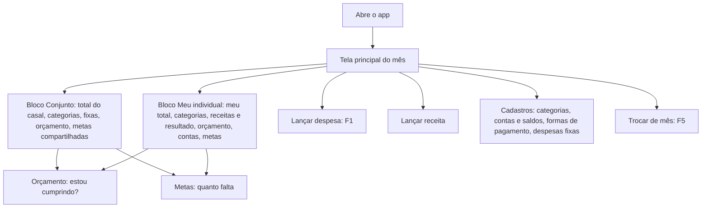
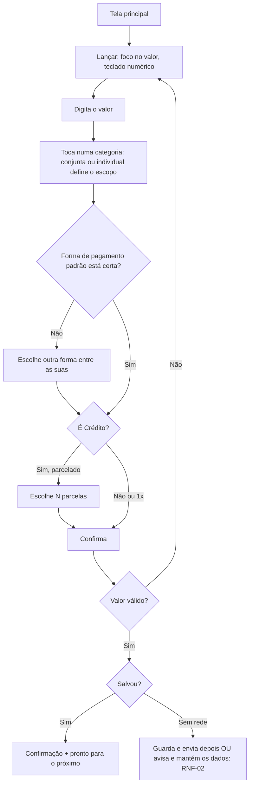
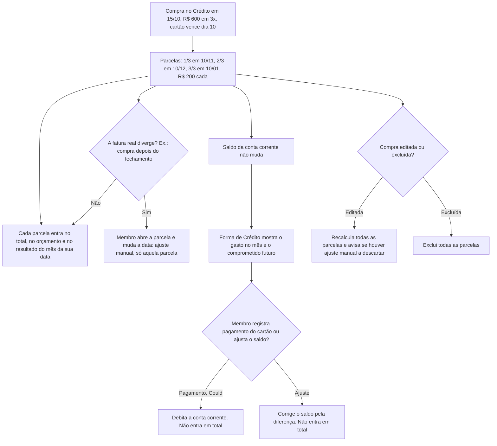
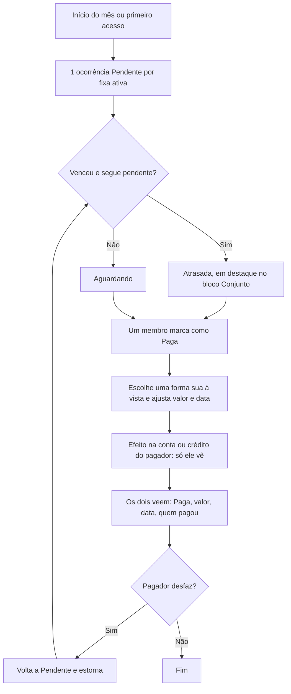

# PRD-TECNICO.md — MyMoney

**Status:** Aprovado pelo stakeholder em 2026-10-09, junto com o PRD.md (Loop A encerrado na
rodada 3). Incorpora as respostas do stakeholder das rodadas 1 a 3, inclusive a nova regra de
competência do crédito e a confirmação da I-20.
**Base:** `.md/PRD.md` (rodada 3), `.md/CTO-REVIEW.md` (Gate 1 e adendo) e `.md/PLANO-COMERCIAL.md`.
**Escopo deste documento:** requisitos e regras. Não toma decisão de arquitetura, banco, framework
ou hospedagem. Essas decisões são do Coordenador no `/definir`. O detalhe de tela é do UX no
`/definir`.

**Glossário**
- **Lar:** o casal, com exatamente 2 membros.
- **Membro:** cada um dos 2 usuários.
- **Escopo:** todo dado é *Individual* (de um membro) ou *Conjunto* (do lar).
- **Categoria:** tem um **tipo** (*Despesa* ou *Receita*) e um **escopo** (*Conjunta* ou
  *Individual*). **A categoria define o escopo do lançamento.** Categoria individual é privada do
  dono.
- **Conta:** conta corrente individual, com saldo. Não existe conta conjunta.
- **Forma de pagamento:** cadastro individual e privado do membro, com nome livre e tipo: *Pix* ou
  *Débito* (ligada a uma conta corrente) ou *Crédito* (um cartão de crédito, com **dia de
  vencimento** obrigatório). Exemplos: "Pix Nubank", "Débito Itaú", "Cartão de crédito XP".
- **Compra no crédito:** compra numa forma de Crédito, à vista (1x) ou em N parcelas mensais. Toda
  parcela tem data própria, no dia de vencimento do cartão, a partir do mês seguinte à compra
  (RN-14).
- **Pagador:** quem pagou uma despesa conjunta.
- **Gasto variável:** despesa numa categoria marcada como "variável".
- **Despesa fixa conjunta:** um modelo recorrente que gera uma ocorrência por mês, com status
  *Pendente* ou *Paga*.
- **Competência:** o mês em que um valor conta nos totais, no orçamento e no resultado. Em Pix e
  Débito, é o mês da compra. No Crédito, é o mês da data de cada parcela.
- **Tela principal:** o resumo do mês, com o bloco Conjunto no topo e o bloco Meu individual
  abaixo.

---

## 1. Requisitos Funcionais

Critérios de aceite em formato EARS. Prioridade entre parênteses (ver PRD.md, Seção 5).

### Acesso

**RF-01: Login restrito aos membros** (RA-01, Must)
- CA-01.1: Quando uma pessoa informa credenciais de um dos 2 membros, o sistema deve dar acesso aos
  dados daquele membro e aos dados conjuntos do lar.
- CA-01.2: Se alguém tentar criar conta ou entrar com um e-mail que não é de um dos 2 membros, então
  o sistema deve recusar. Não existe cadastro público.
- CA-01.3: Enquanto o membro não sair de propósito, o sistema deve mantê-lo logado no app
  instalado.
- CA-01.4: Quando o membro sai, o sistema deve encerrar a sessão daquele dispositivo.

### Cadastros do membro

**RF-02: Contas correntes e saldos** (RA-04, Must)
- CA-02.1: Quando o membro cadastra uma conta com nome e saldo inicial (padrão R$ 0,00), o sistema
  deve criá-la como individual dele.
- CA-02.2: O sistema deve mostrar o saldo atual de cada conta (RN-12).
- CA-02.3: Quando o membro informa o saldo real atual de uma conta, o sistema deve registrar um
  **ajuste de saldo** pela diferença. O ajuste não conta como receita nem como despesa em nenhum
  total, orçamento ou resultado (RN-12, I-14).
- CA-02.4: Quando o membro arquiva uma conta, o sistema deve tirá-la das opções e manter o
  histórico.
- CA-02.5: Se o membro tentar excluir uma conta com lançamentos ou formas de pagamento ligadas,
  então o sistema deve impedir e oferecer o arquivamento.

**RF-03: Formas de pagamento** (RA-05, Must)
- CA-03.1: Quando o membro cadastra uma forma de pagamento do tipo Pix ou Débito, com nome e conta
  corrente de origem (obrigatória), o sistema deve criá-la como individual e privada dele.
- CA-03.2: Quando o membro cadastra uma forma do tipo Crédito, com nome (por exemplo, "Cartão de
  crédito XP") e **dia de vencimento** (obrigatório, de 1 a 31), o sistema deve criá-la como
  individual e privada. A conta corrente de pagamento é opcional e só serve de padrão no RF-19.
- CA-03.2a: Se o dia de vencimento estiver vazio ou fora de 1 a 31, então o sistema deve impedir o
  cadastro da forma de Crédito.
- CA-03.2b: Quando o membro altera o dia de vencimento de um cartão, o sistema deve aplicar o novo
  dia só às compras lançadas depois da alteração. As parcelas já geradas mantêm a data (I-19).
- CA-03.3: Para cada forma de Crédito, o sistema deve mostrar ao dono o **gasto no mês**
  (parcelas com data no mês) e o **comprometido em meses futuros** (RN-13).
- CA-03.4: O membro deve poder marcar uma forma como *preferida* (RN-19).
- CA-03.5: Quando o membro arquiva uma forma, o sistema deve tirá-la das opções e manter o
  histórico. Se ele tentar excluir uma forma com lançamentos, então o sistema deve impedir e
  oferecer o arquivamento.

**RF-04: Categorias** (RA-06, Must)
- CA-04.1: Toda categoria tem tipo (Despesa ou Receita) e escopo (Conjunta ou Individual). As
  categorias de despesa têm a marca "variável" (sim ou não), que pode ser editada. As
  **categorias de Receita são sempre individuais** (I-06).
- CA-04.2: No primeiro uso, o sistema deve criar uma lista inicial:
  - **Despesa conjunta:** Mercado (variável), Delivery/iFood do casal (variável), Moradia, Contas
    da casa, Outros da casa.
  - **Despesa individual (para cada membro):** Almoço/Alimentação fora (variável), Delivery pessoal
    (variável), Transporte (variável), Lazer pessoal (variável), Outros.
  - **Receita individual (para cada membro):** Salário, Extra, Outros.
- CA-04.3: Quando um membro cria, renomeia ou arquiva uma categoria conjunta, o sistema deve
  refletir a mudança para os dois.
- CA-04.4: Quando um membro cria, renomeia ou arquiva uma categoria individual, o sistema deve
  aplicar a mudança só para ele. O outro nunca vê as categorias individuais dele (RN-17, PR-06).
- CA-04.5: Se um membro tentar excluir uma categoria em uso, então o sistema deve impedir e
  oferecer o arquivamento.

### Lançamentos

**RF-05: Lançamento rápido de despesa** (RA-02, Must; ver RNF-01)
- CA-05.1: Quando o membro abre o app instalado, o sistema deve oferecer o lançamento de despesa em
  no máximo 1 toque a partir da tela principal.
- CA-05.2: Quando a tela de lançamento abre, o sistema deve colocar o foco no valor, com teclado
  numérico, e já preencher a data (hoje) e a forma de pagamento (preferida ou última usada, RN-19).
- CA-05.3: O sistema deve mostrar as categorias de despesa mais usadas pelo membro, entre as
  conjuntas e as individuais dele, com seleção em 1 toque e indicação visual de conjunta ou
  individual.
- CA-05.4: Quando o membro escolhe a categoria, o sistema deve definir o escopo do lançamento pelo
  escopo da categoria. Não existe seletor de escopo separado (RN-01).
- CA-05.5: O membro deve poder trocar a forma de pagamento entre as suas com no máximo 2 toques.
- CA-05.6: Quando a forma é do tipo Crédito, o sistema deve oferecer o número de parcelas (padrão
  1x), sem tornar o campo obrigatório (RF-06).
- CA-05.7: Quando o membro confirma um lançamento válido, o sistema deve salvá-lo, mostrar uma
  confirmação visível e permitir um novo lançamento em seguida. No Crédito, a confirmação deve
  dizer em que data cai a 1ª parcela (por exemplo, "1ª parcela em 10/11"), porque a compra não
  entra no total do mês corrente (I-18).
- CA-05.8: Descrição e data diferente de hoje são opcionais.
- CA-05.9: Se o valor for vazio, zero ou negativo, então o sistema deve impedir a confirmação.
- CA-05.10: Quando a categoria é conjunta, o sistema deve tratar a despesa como já paga, com quem
  lançou como pagador (RN-04, RN-05).

**RF-06: Compra no crédito (à vista ou parcelada)** (RA-10, Must)
- CA-06.1: Quando o membro lança uma compra numa forma de Crédito em N parcelas (1 a 24, sendo 1x
  à vista), o sistema deve gerar N parcelas datadas assim (RN-14, I-11):
  - parcela 1 no **dia de vencimento do cartão no mês seguinte** ao da data da compra;
  - parcela k no dia de vencimento do mês seguinte + (k − 1) meses.
- CA-06.1a: Se o dia de vencimento não existir num mês (por exemplo, 31 em fevereiro), então o
  sistema deve usar o último dia daquele mês.
- CA-06.1b: Exemplo: compra em 15/10, em 3x, num cartão que vence no dia 10, gera parcelas em 10/11,
  10/12 e 10/01 do ano seguinte. A mesma compra à vista gera uma parcela única em 10/11. Não existe
  data de fechamento: a regra vale sempre, mesmo para compra feita no próprio dia do vencimento ou
  depois dele.
- CA-06.2: Valor da parcela = total ÷ N, com 2 casas. A diferença de centavos fica na 1ª parcela, e
  a soma das parcelas é sempre igual ao total. Exemplos: R$ 600,00 em 3x dá R$ 200,00 em cada
  parcela; R$ 100,00 em 3x dá R$ 33,34 + R$ 33,33 + R$ 33,33.
- CA-06.3: O sistema deve mostrar cada parcela como "Descrição (k/N)" no mês da data dela. Uma
  compra à vista não mostra "(1/1)".
- CA-06.4: Quando a categoria é conjunta, todas as parcelas devem ser conjuntas, com o mesmo
  pagador.
- CA-06.5: Uma compra no Crédito não deve alterar o saldo de nenhuma conta corrente (RN-13).

**RF-07: Receita** (RA-07, Must)
- CA-07.1: Quando o membro registra uma receita com valor, categoria de receita (individual),
  conta corrente de destino, data (padrão hoje) e descrição opcional, o sistema deve salvá-la como
  individual e somá-la ao saldo da conta.

**RF-08: Editar e excluir lançamentos** (RA-11, Must)
- CA-08.1: Quando o dono de um lançamento individual o edita ou exclui, o sistema deve aplicar a
  mudança e recalcular saldos, totais e resultados.
- CA-08.2: Quando qualquer membro edita descrição, valor, data ou categoria de uma despesa
  conjunta, trocando por outra categoria conjunta, o sistema deve aplicar a mudança e registrar
  quem alterou por último (RN-06).
- CA-08.3: Se alguém que não é o pagador tentar alterar a forma de pagamento ou as parcelas de uma
  despesa conjunta, então o sistema deve impedir. Para ele, esses campos nem aparecem (RN-04,
  RN-06).
- CA-08.4: Quando quem lançou troca a categoria por outra de escopo diferente, o sistema deve mudar
  o escopo conforme a RN-07. Ninguém mais pode fazer essa troca.
- CA-08.5: Quando o dono ou pagador de uma compra no crédito **altera a data de uma parcela**, o
  sistema deve mudar só aquela parcela, que passa a contar no mês da nova data. Esse é o **ajuste
  manual** previsto pelo stakeholder para qualquer diferença em relação à fatura real (RN-14).
  Valor e categoria de uma parcela isolada não podem ser editados.
- CA-08.5a: Quando a compra inteira é editada (valor total, número de parcelas, data da compra,
  forma ou categoria), o sistema deve recalcular todas as parcelas pela RN-14. Se houver datas
  ajustadas à mão, o sistema deve avisar antes que esses ajustes serão descartados (I-21).
- CA-08.5b: Quando a compra é excluída, o sistema deve excluir todas as parcelas. Uma parcela
  isolada não pode ser excluída.
- CA-08.6: Antes de qualquer exclusão, o sistema deve pedir confirmação.

**RF-09: Lista de lançamentos do mês** (apoia a M1, Must)
- CA-09.1: O sistema deve listar os lançamentos com competência no mês que o membro pode ver
  (RN-02 a RN-04), com filtros por escopo e categoria e, para os próprios lançamentos, por forma de
  pagamento.
- CA-09.2: Quando o membro aplica um filtro, o sistema deve mostrar o total filtrado. Esse total
  serve para a conferência da M1.

### Despesas fixas conjuntas

**RF-10: Modelo de despesa fixa conjunta** (RA-08, Must)
- CA-10.1: Quando um membro cadastra uma despesa fixa com descrição, categoria conjunta de despesa,
  valor previsto e dia de vencimento (1 a 31), o sistema deve criá-la visível aos dois.
- CA-10.2: Quando um membro encerra uma despesa fixa, o sistema deve parar de gerar ocorrências a
  partir do mês seguinte.

**RF-11: Ocorrências mensais** (RA-08, Must)
- CA-11.1: Quando um mês começa, ou quando um membro abre um mês ainda sem ocorrências, o sistema
  deve ter exatamente 1 ocorrência Pendente por despesa fixa ativa (RN-15).
- CA-11.2: Se o dia de vencimento não existir no mês, então o sistema deve usar o último dia do
  mês.
- CA-11.3: Enquanto uma ocorrência estiver Pendente com o vencimento passado, o sistema deve
  destacá-la como atrasada para os dois.

**RF-12: Marcar despesa fixa como paga** (RA-08, Must)
- CA-12.1: Quando um membro marca uma ocorrência como paga, o sistema deve pedir uma forma de
  pagamento dele (à vista) e permitir ajustar o valor efetivo (padrão: o previsto) e a data
  (padrão: hoje).
- CA-12.2: Quando a ocorrência é paga, o sistema deve aplicar o efeito da forma (RN-12, RN-13) e
  mostrá-la como Paga aos dois, conforme a RN-04.
- CA-12.2a: Quando a ocorrência é paga no Crédito, ela continua contando no mês da própria
  ocorrência nos totais e no orçamento, e não no mês do vencimento do cartão. No cartão do pagador,
  ela aparece como parcela única no próximo vencimento (RN-15, I-20, confirmada em 2026-10-09).
- CA-12.3: Quando o pagador desfaz o pagamento, o sistema deve voltar a ocorrência para Pendente e
  estornar o efeito.

### Tela principal e navegação

**RF-13: Tela principal (resumo do mês)** (RA-09, Must)
- CA-13.1: Quando o membro abre o app, o sistema deve mostrar uma tela principal única do mês
  selecionado, com dois blocos nesta ordem.
- CA-13.2: **Bloco Conjunto, no topo**, igual para os dois membros:
  - o **Total do casal** (só o conjunto, RN-16a), com os gastos variáveis conjuntos em destaque;
  - o total por categoria conjunta;
  - quanto cada membro pagou do conjunto (I-15);
  - as despesas fixas pendentes ou atrasadas;
  - o orçamento conjunto: "estou cumprindo?" (RF-15);
  - o progresso das metas compartilhadas (RF-17).
- CA-13.3: **Bloco Meu individual, abaixo**, só do membro logado:
  - **Meu total** = minha parte no conjunto + meu individual (RN-16b), com as duas parcelas
    visíveis;
  - os gastos variáveis em destaque;
  - o total por categoria;
  - receitas e resultado do mês (RN-16c);
  - o orçamento individual: "estou cumprindo?";
  - o saldo das contas e o gasto no crédito (do mês e futuro);
  - o progresso das metas individuais.
- CA-13.4: O bloco Conjunto não deve conter nenhum dado individual. O bloco Meu individual não
  deve conter nem permitir derivar nenhum dado individual do outro membro (RN-02, RN-16e).
- CA-13.5: De cada bloco, o membro deve chegar ao detalhe correspondente (lista do RF-09 filtrada,
  orçamento, metas). O desenho fica para o UX-SPEC.md.

**RF-14: Navegação entre meses** (RA-09, Must)
- CA-14.1: Quando o membro escolhe outro mês, inclusive meses futuros com parcelas, o sistema deve
  recalcular a tela principal para aquele mês. O mês padrão é o corrente.

### Orçamento e resultado

**RF-15: Orçamento mensal: "estou cumprindo?"** (RA-13, Must)
- CA-15.1: Quando um membro define um valor orçado para uma categoria conjunta de despesa num mês,
  o sistema deve registrá-lo como orçamento conjunto, visível e editável pelos dois.
- CA-15.2: Quando um membro define um valor orçado para uma categoria individual de despesa dele, o
  sistema deve registrá-lo como orçamento individual, visível só a ele.
- CA-15.3: Para cada categoria orçada e para o total de cada escopo, o sistema deve mostrar
  orçado, realizado, percentual e situação: *dentro* (abaixo de 80%), *atenção* (de 80% a 100%) ou
  *estourado* (acima de 100%). O realizado inclui as parcelas com data no mês.
- CA-15.4: Quando o membro abre um mês sem orçamento, o sistema deve oferecer a cópia do mês
  anterior em 1 ação, para cada escopo que ele pode ver.

**RF-16: Resultado do mês** (RA-13, Must)
- CA-16.1: O sistema deve mostrar o resultado conjunto (RN-16d) no bloco Conjunto e o resultado
  individual (RN-16c) no bloco Meu individual.
- CA-16.2: Enquanto o mês não tiver terminado, o sistema deve mostrar o resultado como parcial,
  junto com as fixas pendentes.

### Metas

**RF-17: Metas: "quanto falta"** (RA-14, Must, opção A confirmada em 2026-10-09)
- CA-17.1: Quando um membro cria uma meta com nome, valor-alvo, prazo opcional e escopo (Individual
  ou Compartilhada), o sistema deve criá-la com guardado R$ 0,00.
- CA-17.2: O sistema deve mostrar o **progresso**:
  - guardado;
  - alvo;
  - **quanto falta** (alvo − guardado, nunca menor que zero);
  - percentual;
  - se houver prazo, o valor mensal necessário;
  - o guardado por local ("onde está guardado", RN-09).
- CA-17.3: Quando o guardado atinge o alvo, o sistema deve marcar a meta como atingida.
- CA-17.4: Uma meta individual deve ser visível só ao dono. Uma meta compartilhada deve ser visível
  aos dois (RN-08).

**RF-18: Aportes e retiradas** (RA-14, idem)
- CA-18.1: Quando um membro registra um aporte com valor, data, **onde está guardado** (texto livre,
  por exemplo "CDB Banco X" ou "Caixinha Nubank", com sugestão dos locais já usados) e conta
  corrente de origem opcional, o sistema deve somá-lo ao guardado e, se houver conta de origem,
  debitá-la.
- CA-18.2: Quando um membro registra uma retirada com valor, local e conta de destino opcional, o
  sistema deve subtraí-la do guardado daquele local e, se houver conta de destino, creditá-la.
- CA-18.3: Se a retirada for maior que o guardado naquele local, então o sistema deve impedir.

### Outros

**RF-19: Registro de pagamento do cartão** (RA-15, Could)
- CA-19.1: Quando o membro registra um pagamento com valor, data, conta corrente de origem e forma
  de Crédito de destino, o sistema deve debitar a conta corrente.
- CA-19.2: O pagamento de cartão não é despesa: o sistema não deve contá-lo em nenhum total,
  orçamento ou resultado (RN-13, I-14).

**RF-20: Instalação como PWA** (RA-12, Must; ver RNF-05)
- CA-20.1: O sistema deve ser instalável pelo navegador no Android e por "Adicionar à Tela de
  Início" no Safari do iPhone. Nos dois casos, abre em tela cheia com ícone e nome "MyMoney".
- CA-20.2: Quando o app é aberto pelo navegador num celular e ainda não foi instalado, o sistema
  deve mostrar uma instrução curta de instalação, que pode ser dispensada.

> **Removidos nesta rodada:** o indicador de regularidade (saiu junto com a M2) e a exportação CSV
> (saiu do MVP para acomodar o parcelamento, ver PRD.md, Seção 4).

## 2. Requisitos Não-Funcionais

| # | Categoria | Requisito | Como verificar |
|---|---|---|---|
| RNF-01 | **Fricção de lançamento (crítico, P1)** | Com uma categoria entre as mais usadas e a forma de pagamento padrão, lançar um gasto exige **digitar o valor + no máximo 3 toques**. A mediana de tempo, do app aberto até a confirmação, é de **10 s ou menos**. Trocar a forma ou parcelar fica fora dessa conta | Roteiro com 10 lançamentos cronometrados no Android e no iPhone (M3) |
| RNF-02 | Conexão instável | Um lançamento confirmado nunca se perde em silêncio. Sem rede, o sistema guarda e envia depois, ou avisa e mantém os dados preenchidos. A escolha é do Coordenador | Teste com modo avião |
| RNF-03 | Desempenho | Do ícone até o lançamento pronto: 3 s ou menos em 4G. Tela principal: 2 s ou menos com até 2 anos de dados (cerca de 6.000 lançamentos, contando parcelas) | Medição em celular de gama média |
| RNF-04 | **Privacidade e isolamento** | As regras RN-02 a RN-10, RN-16e e RN-17 valem **no servidor e nos dados**. Um membro não consegue obter dado individual do outro (lançamentos, contas, formas de pagamento, categorias, orçamentos, metas individuais, origem de aporte, forma e conta de uma despesa conjunta) por nenhum caminho: tela, chamada direta à API, erro, contagem ou total | Testes automatizados com a sessão de um membro tentando ler e alterar dados do outro. Revisão do Validador |
| RNF-05 | PWA | Instalável no Chrome do Android e no Safari do iOS (versões no `/definir`). Responsivo, com prioridade para o celular | Instalação nos 2 aparelhos |
| RNF-06 | Segurança | Só HTTPS. Segredos fora do repositório. Nenhum dado financeiro em logs de terceiros. Sessão revogável | `SECURITY-REVIEW.md` |
| RNF-07 | Disponibilidade e dados | Sem indisponibilidade por pausa de inatividade da infraestrutura gratuita, sem mitigação adotada (P5). ~~Cópia de segurança recuperável pelo menos semanal~~: **retirado do MVP por decisão do stakeholder em 2026-10-09** ("são informações não críticas"). Perda irrecuperável aceita; dívida técnica registrada no `SDD.md` §6 e no ADR-010 (Adiado) | `SDD.md` e `DEPLOY.md` |
| RNF-08 | Custo | Planos gratuitos (alvo de R$ 0 a R$ 40 por ano). Qualquer item pago exige aprovação do stakeholder | `SDD.md` |
| RNF-09 | Localização e precisão | pt-BR. Formato R$ 1.234,56. Cálculo monetário exato (a soma das parcelas é igual ao total). Datas dd/mm/aaaa. Fuso America/Sao_Paulo | Testes de parcelas, arredondamento e virada de mês e ano |
| RNF-10 | Acessibilidade | Alvos de toque de pelo menos 44×44 px. Contraste WCAG 2.1 AA. Campos com rótulo | UX-SPEC.md |
| RNF-11 | Manutenibilidade (hobby) | Solução simples, que uma pessoa sozinha mantenha | Critério do Coordenador |

## 3. Regras de Negócio

### Privacidade (núcleo)

| # | Regra | Racional |
|---|---|---|
| RN-01 | **A categoria define o escopo.** Categoria conjunta gera lançamento Conjunto. Categoria individual gera lançamento Individual do dono | Resposta 2, confirmada em 2026-10-09 |
| RN-02 | Dado individual é visível e editável **só pelo dono**. Não aparece ao outro em lista, total, contagem, busca ou erro | "Um não visse as contas individuais do outro" |
| RN-03 | **Contas e formas de pagamento são sempre individuais e privadas.** Nome, tipo, saldo, gastos no crédito e movimentos são visíveis só ao dono. Não existe conta conjunta | Respostas 6 e 7 e complemento da rodada 2, confirmados em 2026-10-09 |
| RN-04 | Na **despesa conjunta**, os dois veem descrição, categoria, valor, data (no crédito, a data da parcela), status, **quem pagou** e a indicação de parcela (k/N), quando houver (I-13, confirmada). **Só o pagador** vê a forma de pagamento, a conta usada e a data original da compra no crédito | Resposta 4 e complemento da rodada 2: "o outro vê quem pagou, mas não a forma nem a conta" (confirmado em 2026-10-09) |
| RN-05 | Pagar uma despesa conjunta afeta a conta ou o crédito do pagador. O efeito aparece só para ele | Saldo correto sem expor a conta |
| RN-06 | Qualquer membro pode criar, editar e excluir despesas conjuntas e fixas, dentro de categorias conjuntas. **Só o pagador** troca a forma, as parcelas ou desfaz o pagamento. O sistema registra quem alterou por último | A despesa é dos dois. A forma é dado individual |
| RN-07 | **Mudança de escopo:** só quem lançou pode trocar a categoria por outra de escopo diferente. Ao passar de conjunta para individual, a despesa some do bloco Conjunto. Ao passar de individual para conjunta, aparece aos dois conforme a RN-04 | Impede mover gasto do outro (I-03) |
| RN-08 | **Meta compartilhada:** os dois veem nome, alvo, prazo, guardado, quanto falta, guardado por local e cada aporte ou retirada (valor, data, autor e onde está guardado). **Só o autor** vê a conta de origem ou destino. Meta individual é visível só ao dono | Resposta 5, confirmada em 2026-10-09 |
| RN-09 | "Onde está guardado" é um texto livre informado no aporte e na retirada. Não é conta cadastrada e não expõe conta nenhuma. Aporte com conta de origem debita a conta. Retirada com conta de destino credita a conta | Resposta 5 |
| RN-10 | O isolamento é garantido no servidor e nos dados, não só escondido na tela | Dado sensível (R8) |
| RN-11 | Existe um único lar, com exatamente 2 membros pré-cadastrados | Público de 2 usuários |

### Contas, formas de pagamento e competência

| # | Regra | Racional |
|---|---|---|
| RN-12 | **Vínculo forma → conta e saldo:** forma Pix ou Débito sempre aponta para uma conta corrente do mesmo membro. Saldo da conta = saldo inicial + receitas − despesas pagas com formas Pix ou Débito ligadas a ela − aportes com origem nela + retiradas com destino nela ± ajustes de saldo − pagamentos de cartão com origem nela. Pix e Débito afetam o saldo na data do lançamento | Complemento da rodada 2 (vínculo forma → conta). Ajuste e pagamento de cartão não são receita nem despesa |
| RN-13 | **Crédito não afeta saldo de conta corrente, nem na compra nem na data da parcela.** Cada forma de Crédito mostra o gasto no mês (parcelas com data no mês) e o comprometido futuro. O saldo da conta corrente só reflete o cartão por pagamento de cartão (RF-19, Could) ou por ajuste de saldo (RF-02). **Fatura fica fora do escopo** | Resposta 6. Reflete quando o dinheiro sai de fato, sem contar duas vezes (I-14) |
| RN-14 | **Competência:** Pix e Débito contam no mês da data da compra. **Crédito (à vista ou parcelado):** a parcela 1 tem data no **dia de vencimento do cartão no mês seguinte** ao da compra, e a parcela k no dia de vencimento do mês seguinte + (k − 1). Num mês sem aquele dia, vale o último dia do mês. A competência de cada parcela é o mês da data dela. **Não há data de fechamento:** a regra é sempre "mês seguinte". Qualquer diferença em relação à fatura real é ajuste manual da data da parcela (CA-08.5). Valor = total ÷ N, com 2 casas e os centavos na 1ª parcela. Exemplo: R$ 600,00 em 3x, comprada em 15/10, cartão com vencimento no dia 10, dá R$ 200,00 em 10/11, 10/12 e 10/01 | Regra do stakeholder, confirmada em 2026-10-09 (I-11). Substitui a regra "1ª parcela no mês da compra" da rodada 2. Alinha o mês do app com o mês em que a fatura é paga (M1) |
| RN-15 | Cada despesa fixa ativa gera **exatamente 1** ocorrência por mês, com valor previsto editável no pagamento. A fixa é paga à vista (Pix, Débito ou Crédito 1x). **A competência da fixa é sempre o mês da ocorrência**, mesmo quando paga no Crédito. No cartão, ela aparece no próximo vencimento (I-20, confirmada em 2026-10-09) | Evita duplicidade (I-08). A conta de outubro continua sendo de outubro na visão da casa |

### Totais e resultados

| # | Regra | Racional |
|---|---|---|
| RN-16a | **Total do casal (mês)** = soma das despesas conjuntas com competência no mês: variáveis, parcelas e fixas pagas. **Só o conjunto.** Fixas pendentes aparecem à parte como "previsto a pagar" | Resposta 3, confirmada em 2026-10-09 |
| RN-16b | **Meu total (mês)** = **minha parte no conjunto** + minhas despesas individuais com competência no mês. **Minha parte no conjunto** = soma das despesas conjuntas do mês que **eu registrei como pagas por mim**, também mostrada por categoria conjunta | Respostas 3 e 8. I-10 confirmada em 2026-10-09 |
| RN-16c | **Resultado individual (mês)** = minhas receitas − Meu total. Aportes em metas aparecem como "guardado no mês" e não reduzem o resultado. O orçamento individual compara só as categorias individuais | Resposta 8, confirmada em 2026-10-09 (I-05) |
| RN-16d | **Resultado conjunto (mês)** = orçamento conjunto total − Total do casal, também mostrado por categoria | "Resultado no fim do mês" da casa |
| RN-16e | **Garantia de privacidade dos totais:** Meu total e Resultado individual usam só dados do próprio membro e despesas conjuntas em que ele é o pagador. Nenhum total mostrado a um membro usa dado individual do outro. "Quanto cada um pagou do conjunto" vem só de dados conjuntos e de pagadores já visíveis | Exigência do stakeholder |

### Categorias e lançamento

| # | Regra | Racional |
|---|---|---|
| RN-17 | Categoria tem **tipo** (Despesa ou Receita) e **escopo** (Conjunta ou Individual). Categorias conjuntas são visíveis e editáveis pelos dois. **Categorias individuais são privadas do dono.** Categorias de receita são sempre individuais. Só as de despesa têm a marca "variável" | Fluxo do stakeholder ("receitas e despesas dentro de cada categoria") e resposta 2. Privacidade das categorias individuais confirmada em 2026-10-09 (PR-06) |
| RN-18 | Valores sempre positivos, em BRL, com 2 casas. O tipo do lançamento define o efeito no cálculo | Evita erro de sinal |
| RN-19 | Padrões do lançamento rápido: data = hoje (fuso de São Paulo); forma = a preferida ou, se não houver, a última usada; parcelas = 1x. A categoria sempre exige 1 toque, porque define o escopo | Reduz toques (RNF-01) sem errar o escopo |

## 4. Fluxos de Usuário/Processo

### F0: Fluxo geral do app (como o stakeholder imagina)

### F1: Lançamento rápido de despesa (RF-05, RF-06)

Caminho feliz: valor, categoria e confirmar. São 2 toques mais a digitação.

### F2: Compra no crédito (RF-06, RF-08, RF-19)

### F3: Ciclo mensal de despesa fixa conjunta (RF-10 a RF-12)

### F4: Matriz de visibilidade

| Dado | Dono, pagador ou autor | Outro membro |
|---|---|---|
| Conta corrente (nome, saldo, movimentos, ajustes) | Vê e edita | **Não vê nada** |
| Forma de pagamento (nome, tipo, gasto no crédito) | Vê e edita | **Não vê nada** |
| Categoria individual (despesa ou receita) e seus lançamentos | Vê e edita | **Não vê nada**, nem em totais |
| Despesa conjunta: descrição, categoria, valor, data (no crédito, a data da parcela), status, parcela k/N | Vê e edita | Vê e edita (exceto forma, parcelas e datas de parcela) |
| Despesa conjunta no crédito: data original da compra | Vê | **Não vê** |
| Despesa conjunta: quem pagou | Vê | **Vê** |
| Despesa conjunta: forma de pagamento e conta | Vê | **Não vê** |
| Quanto cada um pagou do conjunto no mês | Vê | Vê |
| Meu total, receitas, resultado individual | Vê | **Não vê** |
| Orçamento conjunto e "estou cumprindo" conjunto | Vê e edita | Vê e edita |
| Orçamento individual | Vê e edita | **Não vê** |
| Meta compartilhada: alvo, guardado, quanto falta, aportes (valor, data, autor, onde está guardado) | Vê | Vê |
| Meta compartilhada: conta de origem ou destino | Vê (autor) | **Não vê** |
| Meta individual | Vê e edita | **Não vê** |

### F5: Fechamento do mês e conferência da M1

1. No mês seguinte, cada membro abre o mês anterior na tela principal.
2. No bloco Conjunto, o casal confere os variáveis conjuntos, o orçamento ("cumprimos?") e o
   resultado conjunto.
3. Cada um filtra os próprios lançamentos variáveis (individuais e conjuntos que pagou) por
   categoria e forma (RF-09) e compara:
   - Pix e Débito com o extrato do mês;
   - cada cartão com a **fatura que vence no mês**, porque as parcelas caem no vencimento.
   No 1º mês de uso, o crédito fica fora da conferência, porque a fatura desse mês tem compras de
   antes do app (PRD.md, M1). Quando a parcela do app cair num mês diferente do da fatura real (por
   exemplo, compra depois do fechamento), o membro ajusta a data da parcela.
4. **Ponto de decisão:** se a diferença passar de 10%, o membro lança o que faltou e anota a causa.
   Se a causa for fricção, ela alimenta melhorias de RNF-01.
5. Copia o orçamento para o novo mês (RF-15).

## 5. Dependências entre Requisitos e Integrações Externas

### Dependências entre requisitos

| Requisito | Depende de | Por quê |
|---|---|---|
| RF-03 (formas) | RF-02 | Pix e Débito apontam para uma conta |
| RF-05 (lançamento rápido) | RF-01, RF-03, RF-04 | Forma de pagamento e categoria (que define o escopo) |
| RF-06 (parcelado) | RF-05, RF-03 (Crédito) | Variação do lançamento no Crédito |
| RF-07 (receita) | RF-02, RF-04 | Conta de destino e categoria de receita |
| RF-08, RF-09 | RF-05, RF-06, RF-07 | Agem sobre lançamentos |
| RF-11, RF-12 | RF-10, RF-03 | Ocorrência vem do modelo. O pagamento exige forma |
| RF-13, RF-14 (tela principal) | RF-05 a RF-07, RF-12; RF-15 a RF-17 para os indicadores de orçamento e metas | Agrega por competência, escopo e pagador. Os blocos de orçamento e metas aparecem quando esses RFs existirem |
| RF-15, RF-16 | RF-04, RF-05, RF-06 | Orçado × realizado por categoria |
| RF-17, RF-18 | RF-01, RF-02 (opcional) | A conta de origem é opcional |
| RF-19 | RF-02, RF-03 | Conta corrente e forma de Crédito |
| RNF-04 / RN-02 a RN-10, RN-16e, RN-17 | Transversal | O isolamento vale desde o primeiro requisito implementado |

### Integrações externas e restrições de plataforma

| Integração | Papel | Restrição ou risco | Decisão de |
|---|---|---|---|
| **Supabase** (projeto `xrcxbzrglndetrrhavhc`) | Restrição de stack (R7) | O plano gratuito pausa após 1 semana de inatividade ([supabase.com/pricing](https://supabase.com/pricing)). Ambiente a limpar | Coordenador (`/definir`) |
| **Vercel** (`leandrosegheto17s-projects/mymoney`) | Restrição de stack: hospedagem | Plano Hobby, para uso não comercial, o que é compatível. Ambiente a limpar | Coordenador |
| **GitHub** (`leandrosegheto17/MyMoney`) | Repositório | Repositório a limpar. Segredos fora do repositório | Coordenador e Validador |
| **Servidor próprio e Cloudflare** do casal | Alternativa ou mitigação (pausa, backup do RNF-07) | Uso opcional | Coordenador |
| **Navegadores** (Chrome no Android, Safari no iOS) | Plataforma do PWA | No iOS, a instalação é manual. Notificações web só a partir do iOS 16.4 ([WebKit](https://webkit.org/blog/13878/web-push-for-web-apps-on-ios-and-ipados/)), e notificações estão fora do escopo | Coordenador (P4) |
| Bancos, Open Finance, operadoras de cartão | **Nenhuma** | — | — |

**Limpeza dos ambientes:** autorizada pelo stakeholder. Só acontece como tarefa explícita do
TASK.md, com confirmação do usuário no momento (CTO-REVIEW.md, ressalva 6).

## 6. Premissas e Riscos Resolvidos

| # | Premissa ou risco | Situação | Evidência |
|---|---|---|---|
| PR-01 | Critério de sucesso | **Confirmada em 2026-10-09**: M1, M3 e M4 (M2 removida) | Resposta 1 |
| PR-02 | A categoria define o escopo | **Confirmada em 2026-10-09** | Resposta 2 e fluxo do stakeholder |
| PR-03 | Total do casal = só conjunto. Meu total = minha parte + meu individual, em que minha parte = o que eu registrei como pago por mim | **Confirmada em 2026-10-09** | Respostas 3 e 8 e resposta 1 da rodada 3 |
| PR-04 | Pix, Débito e Crédito, com parcelamento. Crédito no vencimento do cartão a partir do mês seguinte. Sem fechamento | **Confirmada em 2026-10-09** (regra revisada pelo stakeholder) | Resposta 6 e resposta 2 da rodada 3 |
| PR-05 | Não existe conta conjunta | **Confirmada em 2026-10-09** | Resposta 7 |
| PR-06 | Contas, formas de pagamento e categorias individuais são privadas | **Confirmada em 2026-10-09** | Complemento da rodada 2 e resposta 5 da rodada 3 |
| PR-07 | Prazo: opção A, tudo no MVP | **Confirmada em 2026-10-09** | Resposta 3 da rodada 3 |
| R-01 = P1 | Fricção do lançamento | **Mitigado no requisito**: RNF-01, RF-05 e RN-19. A categoria definir o escopo tirou 1 toque | PLANO-COMERCIAL.md |
| R-02 = P2 | Escopo de hobby | **Mitigado**: cortes (CSV, pagamento de cartão como Could, indicador) e ordem de entrega. Cerca de +2 semanas aceitas pelo stakeholder (opção A) | PRD.md, Seção 4. CTO-REVIEW.md, adendo |
| R-03 = P3 | Casos de borda da privacidade | **Resolvido**: RN-03, RN-04, RN-08, RN-16e e RN-17 | Respostas 4, 5, 7 e complemento |
| R-04 = P6 | A visibilidade muda o comportamento | Não validável antes do uso (M4) | PLANO-COMERCIAL.md |
| R-05 = P5 | Pausa do Supabase Free | **Encaminhado** (RNF-07). Decisão no `/definir` | supabase.com/pricing |
| R-06 | "Minha parte = o que paguei" e a percepção de quem paga mais | **Aceito** pelo stakeholder ao confirmar a I-10 | RN-16b |
| R-07 | A regra fixa do crédito diverge da fatura real (compra depois do fechamento) | **Aceito**: ajuste manual da data da parcela (CA-08.5) | Fala do stakeholder: "qualquer coisa diferente disso é ajuste manual" |
| P4 | PWA no iOS | **Parcialmente confirmado**. O resto fica com o Coordenador | WebKit |
| LGPD | Conformidade formal | **Refutada para este uso** (art. 4º, I, Lei 13.709/2018). Segurança e isolamento seguem como requisito | Lei 13.709/2018 |

## 7. Interpretações Registradas

| # | Ambiguidade | Interpretação | Por quê | Situação |
|---|---|---|---|---|
| I-01 | O outro vê quem pagou a despesa conjunta? | Sim. A forma e a conta ficam ocultas | — | **Confirmada em 2026-10-09** (resposta 4 e complemento) |
| I-02 | Aporte em meta compartilhada | Valor, data, autor e onde está guardado visíveis. Conta de origem oculta | — | **Confirmada em 2026-10-09** |
| I-03 | Quem muda o escopo de um lançamento | Só quem lançou, trocando a categoria | Impede mover gasto do outro | Interpretação do Gestor |
| I-04 | Despesa conjunta variável já nasce paga? | Sim, pela forma de quem lançou | Lançada na hora | Interpretação do Gestor |
| I-05 | O que cada um pagou da casa reduz o resultado individual? | Sim | — | **Confirmada em 2026-10-09** |
| I-06 | Receitas e categorias de receita podem ser conjuntas? | Não. Receita e categoria de receita são sempre individuais | Não existe conta conjunta para receber | Interpretação do Gestor |
| I-07 | Categorias individuais visíveis ao outro? | Não, são privadas | Leitura natural da resposta 2 | **Confirmada em 2026-10-09** |
| I-08 | Fixa com valor variável | Valor previsto, ajustável no pagamento | — | Interpretação do Gestor |
| I-09 | O que conta como "variável" | A marca da categoria de despesa | Torna a M1 mensurável | Interpretação do Gestor |
| I-10 | Como se calcula "minha parte no conjunto" | O que cada um registrou como pago por ele nas despesas conjuntas do mês, também por categoria | Coerente com a resposta 8 | **Confirmada em 2026-10-09** |
| I-11 | Data e mês das parcelas no crédito | A parcela 1 cai no dia de vencimento do cartão no mês seguinte à compra, e a parcela k no mês seguinte + (k − 1). Sem fechamento. Divergência é ajuste manual. **Substitui** a regra da rodada 2 ("1ª parcela no mês da compra") | Regra definida pelo stakeholder | **Confirmada em 2026-10-09** |
| I-12 | Centavos das parcelas | Ficam na 1ª parcela. A soma é igual ao total | Soma exata | Interpretação do Gestor |
| I-13 | O outro vê a indicação "parcela k/N" de uma despesa conjunta? | Sim. Ele não vê a forma (nome nem tipo), a conta nem a data original da compra | Equilíbrio entre prever o conjunto e não expor a forma | **Confirmada em 2026-10-09** |
| I-14 | Como o crédito chega à conta corrente sem fatura | Por pagamento de cartão (Could) ou por ajuste de saldo (Must). Nenhum dos dois conta como despesa | Evita contar duas vezes e mantém o saldo corrigível | Interpretação do Gestor |
| I-15 | O bloco Conjunto mostra quanto cada um pagou do conjunto? | Sim | Vem só de dados conjuntos, e o pagador já é visível | Interpretação do Gestor |
| I-16 | Tela principal × visões separadas | Uma tela principal única: bloco Conjunto no topo e bloco Meu individual abaixo. Telas de detalhe são navegação a partir dela | Fluxo do stakeholder (complemento da rodada 2) | **Confirmada em 2026-10-09** |
| I-17 | Formas de pagamento: lista fixa ou cadastro? | Cadastro individual e privado, com tipo Pix, Débito ou Crédito. Pix e Débito ligados a uma conta corrente | Fluxo do stakeholder ("cadastrar minhas formas de pagamento") | **Confirmada em 2026-10-09** (vínculo com conta registrado como regra na RN-12) |
| I-18 | Crédito à vista (1x) segue a regra do vencimento? | Sim: parcela única no vencimento do mês seguinte. A confirmação do lançamento mostra a data da 1ª parcela, porque a compra não entra no total do mês corrente | Coerência com a regra do stakeholder e com a fatura. O aviso evita a sensação de "lancei e não apareceu" | Interpretação do Gestor (coerente com a regra confirmada) |
| I-19 | Mudar o dia de vencimento de um cartão afeta parcelas já geradas? | Não. Vale só para compras lançadas depois. Parcelas existentes se ajustam à mão | Evita mudar meses já conferidos sem o membro perceber | Interpretação do Gestor |
| I-20 | Despesa fixa conjunta paga no Crédito: em que mês conta? | No **mês da ocorrência** (a conta de outubro é de outubro) nos totais e no orçamento da casa. No cartão do pagador, aparece no próximo vencimento | A regra do crédito do stakeholder foi pensada para compras, e a visão "contas da casa do mês" perderia o sentido se a conta de outubro, já paga, contasse em novembro. **Custo:** o total do cartão e o total da casa ficam em meses diferentes para esse caso | **Confirmada em 2026-10-09** (padrão aceito pelo stakeholder) |
| I-21 | Editar a compra inteira descarta ajustes manuais de data? | Sim, com aviso antes de salvar | Recalcular todas as parcelas é a única forma consistente quando valor ou número de parcelas muda | Interpretação do Gestor |
| I-22 | A data da parcela de uma despesa conjunta é visível ao outro? | Sim, porque define o mês em que ela conta para o casal. A data original da compra e o cartão ficam ocultos. **Efeito colateral:** o dia da parcela pode deixar implícito o dia de vencimento do cartão do pagador | Necessário para o total do casal por mês | Interpretação do Gestor |
