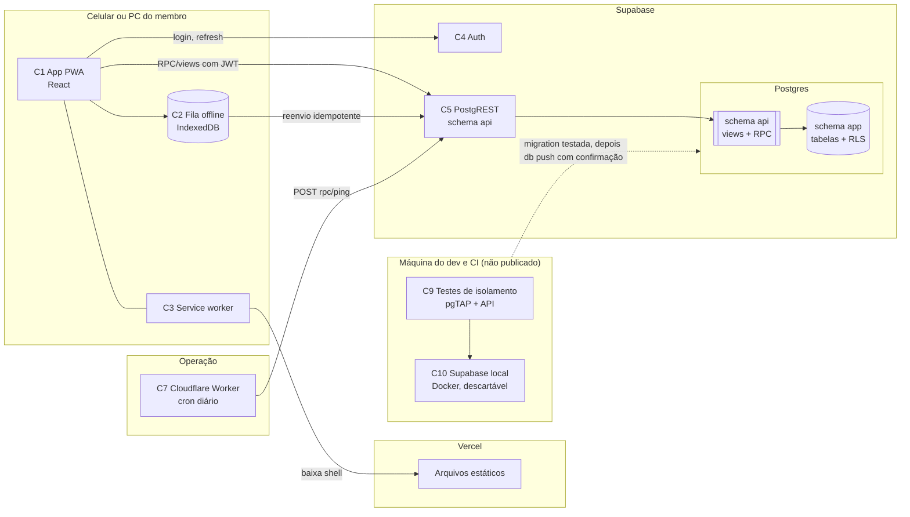
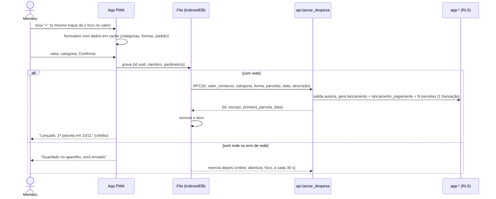
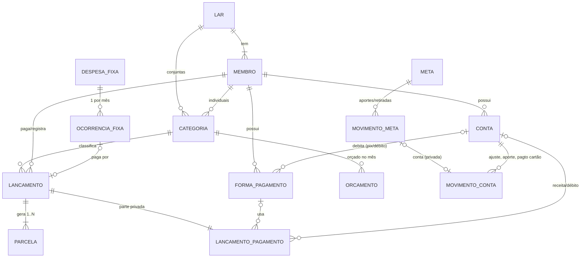

# SDD.md — MyMoney

**Status:** Aprovado pelo stakeholder em 2026-10-09, junto com o UX-SPEC.md e o mockup (Loop B encerrado). ADRs
001 a 009 e 011 aceitos; ADR-010 adiado. ADR-012 aceito em 2026-10-09 (Loop C, rodada 2: funções auxiliares de RLS na
lista fechada de `SECURITY DEFINER`). ADR-013 aceito em 2026-10-10 (BK-0024: "Sair de todos" revoga antes de remover a
sessão local).

**Mudanças da rodada 2** (respostas do stakeholder):
- só existe o ambiente de produção. O Supabase local é ferramenta de teste, não staging (ADR-011);
- aparelhos-alvo: iPhone 17 (iOS 26.x) e Moto Edge 60 (ADR-006);
- o backup saiu do MVP (ADR-010 adiado). A parte de backup do RNF-07 virou dívida aceita;
- a verificação do keep-alive foi refeita no próprio projeto de produção (ADR-009).
**Base:** `.md/PRD-TECNICO.md` (aprovado), `.md/PRD.md`, `.md/CTO-REVIEW.md` (Gate 1 com ressalvas, adendo da
rodada 2) e `.md/PLANO-COMERCIAL.md`.
**ADRs:** `.md/adr/001` a `012`. Aceitos: 001 a 009, 011 e 012. Adiado: 010.

---

## 1. Visão Geral da Arquitetura

O MyMoney é um **PWA estático** (React + Vite, servido pela Vercel) que conversa **direto com o Supabase**, sem
servidor de aplicação próprio (ADR-001). O Postgres do Supabase faz três papéis:

- guarda os dados;
- aplica a **privacidade** por RLS, sobre tabelas que separam fisicamente o que é compartilhável do que é
  privado (ADR-002);
- executa as **regras de negócio** em funções SQL expostas como RPC (ADR-003): parcelas, ocorrências de fixas,
  permissões, saldo, totais e orçamento.

A tela consome um contrato pronto, o schema `api`, e só formata.

Uma rotina de operação fica fora do caminho do usuário e atende a parte de disponibilidade do RNF-07: um
**Cloudflare Worker** agendado mantém o banco acordado (ADR-009). O backup ficou **fora do MVP** por decisão do
stakeholder (ADR-010, adiado; dívida aceita na §6). O servidor próprio do casal não faz parte da arquitetura do
MVP.

**Ambientes:** só **produção** (Supabase + Vercel). O Supabase local (CLI/Docker) roda na máquina do
desenvolvedor e no CI como **ferramenta de teste descartável**, sem dados reais e sem publicação. Não é
staging. Ele é necessário porque os testes de isolamento e de regra não podem rodar sobre os dados reais do
casal (ADR-011).

**Padrão arquitetural:** um monólito de dados, com o banco como núcleo de domínio e um cliente fino. A escolha
se justifica por 4 motivos:

1. **Volume:** 2 usuários e cerca de 6.000 linhas em 2 anos, RNF-03. Não há necessidade de escalar
   horizontalmente.
2. **Equipe:** 1 pessoa, como hobby (RNF-11). Cada runtime a menos é manutenção a menos.
3. **Privacidade como requisito de servidor e dados** (RNF-04, RN-10). O RLS vale para qualquer caminho de
   acesso, inclusive a chamada direta à API.
4. **Custo zero** (RNF-08): Supabase Free, Vercel Hobby e Cloudflare Workers Free.

**Princípios que valem para todo o projeto:**

| # | Princípio | Origem |
|---|---|---|
| P-1 | Nenhum dado individual sai do banco para quem não é o dono. A garantia é a linha que o RLS deixa ver, não a tela | RNF-04, RN-10, ADR-002 |
| P-2 | Toda escrita passa por uma função `api.*` transacional. Nenhuma regra de negócio roda no navegador | ADR-003, CONVENCOES §2 |
| P-3 | Dinheiro é centavo inteiro. Data de negócio é `date` no fuso America/Sao_Paulo | RNF-09, ADR-004 |
| P-4 | Todo total soma **parcelas** pela competência (mês de `parcela.data`) | RN-14, RN-15, ADR-005 |
| P-5 | Um lançamento de despesa confirmado nunca some sem ação do membro | RNF-02, ADR-007 |
| P-6 | Custo zero. Qualquer item pago passa pelo stakeholder | RNF-08 |

## 2. Componentes e Fluxo de Dados

### Componentes

| # | Componente | Onde roda | Responsabilidade | Requisitos |
|---|---|---|---|---|
| C1 | **App PWA** (`frontend/web`) | Navegador (Vercel CDN) | Telas, formatação pt-BR, navegação de mês, cache de dados (TanStack Query), instalação PWA | RF-05, RF-09, RF-13, RF-14, RF-20, RNF-01, RNF-03, RNF-05, RNF-10 |
| C2 | **Fila offline** (dentro do C1, módulo `dados/fila`) | IndexedDB do aparelho | Guardar e reenviar lançamentos de despesa de forma idempotente | RNF-02, ADR-007 |
| C3 | **Service worker** (dentro do C1) | Navegador | Precache do app shell e abertura sem rede | RNF-03, RF-20 |
| C4 | **Supabase Auth** | Supabase | Login por e-mail e senha, sessão, revogação. Cadastro público desligado | RF-01, RNF-06, ADR-008 |
| C5 | **API `api`** (PostgREST sobre o schema `api`) | Supabase | Contrato da aplicação: views e funções de leitura (`security_invoker`) e funções de escrita (RPC) | Todos os RF |
| C6 | **Domínio e dados** (schema `app`, tabelas + RLS + funções internas) | Postgres do Supabase | Tabelas, políticas de RLS, regras de parcelas, fixas, saldo, totais, orçamento e metas | RN-01 a RN-19 |
| C7 | **Keep-alive** (`backend/operacao/keepalive`) | Cloudflare Worker (cron) | Chamar `api.ping()` todo dia | RNF-07, ADR-009 |
| C8 | ~~Backup~~: **fora do MVP** (ADR-010, adiado) | — | — | Dívida aceita (§6) |
| C9 | **Testes de isolamento** (`backend/testes-api`) | Supabase local, na máquina do desenvolvedor e no CI. **Nunca contra a produção** | Duas sessões reais que chamam diretamente cada view e cada RPC tentando ler e alterar dado do outro | RNF-04, ADR-002, ADR-011 |
| C10 | **Supabase local** (ferramenta, não ambiente) | Docker, pela Supabase CLI, descartável | Pilha idêntica à produção para pgTAP, isolamento, e2e e ensaio de migration. Sem dados reais | ADR-011 |

**Bounded contexts.** São 6 contextos, no mesmo banco, separados por arquivos no schema declarativo:

| Contexto | O que cobre | RF |
|---|---|---|
| Acesso | `lar`, `membro`, sessão | RF-01 |
| Cadastros | contas, formas, categorias | RF-02, RF-03, RF-04 |
| Lançamentos | lançamento, pagamento privado, parcelas | RF-05 a RF-09, RF-19 |
| Fixas | modelo e ocorrências | RF-10 a RF-12 |
| Planejamento | orçamento e resultado | RF-15, RF-16 |
| Metas | metas e movimentos | RF-17, RF-18 |

A **leitura agregada** (tela principal) cruza contextos só em `api.resumo_mes`.

### Fronteiras externas

| Integração (PRD-TECNICO §5) | Fronteira na arquitetura |
|---|---|
| Supabase (projeto `xrcxbzrglndetrrhavhc`) | C4 + C5 + C6. A única dependência de runtime do app |
| Vercel (`mymoney`) | Hospedagem estática do C1, só arquivos, sem Functions |
| GitHub (`leandrosegheto17/MyMoney`) | Código, CI (GitHub Actions: lint, testes, pgTAP, isolamento) e integração com a Vercel |
| Servidor próprio | **Não usado no MVP**: o backup foi adiado (ADR-010). Fica como opção para o backup futuro e como plano de saída |
| Cloudflare | C7 (keep-alive). Sem rota HTTP pública |
| Navegadores: iPhone 17 (iOS 26.x, Safari), Moto Edge 60 (Chrome Android) e PC. Mínimo: iOS 18+ e as 2 últimas versões do Chrome | C1 + C3. Instalação manual no iOS. Sem push (fora do escopo) |
| Bancos e Open Finance | Nenhuma |

### Diagrama de componentes



### Fluxo de dados principal: lançamento rápido (F1)



**Outros fluxos:**

- **Tela principal (F0, F5):**
  - o app chama `api.resumo_mes(mes)`;
  - a função garante as ocorrências de fixas do mês (idempotente) e devolve o JSON dos dois blocos já
    calculado, sob o RLS do membro;
  - ao trocar de mês (RF-14), a chamada se repete com outro `mes`.
- **Despesa fixa (F3):**
  - `api.pagar_ocorrencia` cria um lançamento do pagador ligado à ocorrência, com a data da parcela no
    vencimento da ocorrência (I-20);
  - `api.desfazer_pagamento` só funciona para o pagador (RN-06).
- **Crédito (F2):**
  - `api.alterar_data_parcela` muda uma parcela e marca `data_ajustada` (CA-08.5);
  - `api.editar_lancamento` recalcula tudo. Com `p_confirmar_descarte = false` e parcelas ajustadas, a função
    devolve o erro `confirmar_descarte_ajustes` sem gravar, e a tela mostra o aviso (I-21).

### Contrato da API (schema `api`)

**Forma detalhada das respostas:** as tabelas abaixo são um resumo. A forma exata (nomes de campo, aninhamento e
parâmetros) é a de `.md/mockup/respostas/*.json`, que vale sobre esta tabela quando as duas diferem. Exemplos:
`orcamento_mes` também recebe `escopo` e devolve `sem_orcamento`; `dados_lancamento` devolve
`conta_receita_padrao_id`; `resumo_mes` devolve `fixas_total`, `previsto_a_pagar_centavos` e
`minha_parte_por_categoria`. Os testes de contrato de `@mymoney/testes-api` comparam cada resposta com esses
arquivos (TASK.md, D-03).

Todos os valores monetários são centavos inteiros e todas as datas são `YYYY-MM-DD` (ADR-004). Os erros de
regra são exceções com código estável em `message` (ex.: `valor_invalido`, `registro_invalido`,
`sem_permissao`, `confirmar_descarte_ajustes`, `categoria_em_uso`). A tela traduz o código numa mensagem
pt-BR (UX-SPEC §4).

**Leitura** (`security_invoker`, RLS vale):

| Recurso | Entrada | Saída (resumo) | RF |
|---|---|---|---|
| `rpc/contexto` | — | membro atual (id, nome), nome do outro membro, mês corrente | RF-01 |
| `rpc/dados_lancamento` | — | categorias de despesa visíveis, ordenadas por uso **do membro** (id, nome, escopo, variável), categorias de receita, formas ativas (id, nome, tipo, preferida), `forma_padrao_id` (RN-19), contas ativas | RF-05, RF-07 |
| `rpc/resumo_mes` | `mes` | `{conjunto:{total, total_variaveis, por_categoria[], pago_por_membro[], fixas_pendentes[], orcamento, resultado, metas[]}, individual:{meu_total, minha_parte_conjunto, meu_individual, total_variaveis, por_categoria[], receitas, resultado, guardado_no_mes, orcamento, contas[], credito[], metas[]}, mes_fechado, pendentes_previstos}` | RF-13, RF-14, RF-15, RF-16, RF-17 |
| `rpc/lancamentos_mes` | `mes`, `escopo?`, `categoria_id?`, `forma_id?`, `variavel?` | parcelas visíveis do mês ("Descrição (k/N)"), pagador, escopo, mais `total_filtrado`. O filtro por forma só considera os lançamentos do próprio membro | RF-09 |
| `rpc/lancamento` | `id` | cabeçalho + parcelas. Forma, conta e data da operação **só** quando o membro é o pagador. Para o outro, esses campos vêm ausentes, não `null` com rótulo | RF-08 |
| `contas` (view) | — | contas do membro com o saldo atual (RN-12) | RF-02 |
| `formas_pagamento` (view) | — | formas do membro. No Crédito, `gasto_mes` e `comprometido_futuro` (pela data de cartão, ADR-005) | RF-03 |
| `categorias` (view) | — | categorias visíveis (conjuntas + individuais do membro) | RF-04 |
| `despesas_fixas` (view) | — | modelos do lar | RF-10 |
| `rpc/ocorrencias_mes` | `mes` | ocorrências com status (pendente, atrasada ou paga), valor, data e pagador | RF-11, RF-12 |
| `rpc/orcamento_mes` | `mes` | linhas orçadas visíveis com orçado, realizado, %, situação, mais `pode_copiar_anterior` por escopo | RF-15 |
| `metas` (view) | — | metas visíveis com guardado, falta, %, mensal necessário e guardado por local | RF-17 |
| `rpc/movimentos_meta` | `meta_id` | aportes e retiradas (valor, data, autor, local). A conta, só para o autor | RF-18 |
| `rpc/locais_guardados` | — | locais já usados nas metas visíveis (sugestão) | RF-18 |
| `rpc/ping` | — | `1` (único recurso liberado ao `anon`) | RNF-07 |

**Escrita** (RPC, transacional; `security_invoker`, exceto onde indicado):

| Função | Parâmetros principais | Regras aplicadas | RF |
|---|---|---|---|
| `inicializar_membro` | — | Cria as categorias iniciais (CA-04.2). Idempotente | RF-04 |
| `salvar_conta`, `ajustar_saldo`, `arquivar_conta`, `excluir_conta` | id, nome, saldo inicial / saldo real | Ajuste = diferença em `movimento_conta` (não é receita nem despesa). Exclusão impedida com vínculos (`em_uso`) | RF-02 |
| `salvar_forma`, `arquivar_forma`, `excluir_forma`, `definir_preferida` | id, nome, tipo, conta, dia de vencimento | Pix e Débito exigem conta própria. Crédito exige dia de 1 a 31 | RF-03 |
| `salvar_categoria`, `arquivar_categoria`, `excluir_categoria` | id, nome, tipo, escopo, variável | Receita sempre individual. Exclusão impedida em uso | RF-04 |
| `lancar_despesa` | **id (cliente)**, valor, categoria, forma, parcelas (1 a 24), data?, descrição? | RN-01 (escopo pela categoria), RN-14 (parcelas e centavos), RN-05. Idempotente pelo id. Devolve `primeira_parcela_data` | RF-05, RF-06 |
| `lancar_receita` | id, valor, categoria de receita, conta, data?, descrição? | Individual. Soma ao saldo | RF-07 |
| `editar_lancamento` (**`SECURITY DEFINER`**, única exceção no schema `api`; ver §7 item 4) | id, campos, `confirmar_descarte` | RN-06 (o outro membro só altera descrição, valor, data e categoria conjunta), RN-07 (mudar o escopo só por quem lançou), recálculo pela RN-14, registro de `alterado_por` | RF-08 |
| `alterar_data_parcela` | parcela_id, data | Só o pagador. Marca `data_ajustada` | RF-08 |
| `excluir_lancamento` | id | Conjunta: qualquer membro. Individual: o dono. Exclui as parcelas (cascata) | RF-08 |
| `salvar_despesa_fixa`, `encerrar_despesa_fixa` | id, descrição, categoria conjunta, valor previsto, dia | Encerrar remove as ocorrências pendentes dos meses seguintes | RF-10 |
| `pagar_ocorrencia`, `desfazer_pagamento` | ocorrência, forma (à vista), valor?, data? | RN-15, I-20. Desfazer só pelo pagador | RF-12 |
| `definir_orcamento`, `copiar_orcamento` | mês, categoria, valor / mês, escopo | Conjunto: os dois. Individual: o dono | RF-15 |
| `salvar_meta`, `movimentar_meta` | meta, tipo (aporte ou retirada), valor, data, local, conta? | RN-08, RN-09. Retirada não pode passar do guardado no local (CA-18.3) | RF-17, RF-18 |
| `registrar_pagamento_cartao` (Could) | valor, data, conta, forma de crédito | Debita a conta. Não entra em nenhum total | RF-19 |

**Interpretação técnica registrada.** Numa despesa fixa paga, o outro membro vê o **vencimento da ocorrência**
como data, além de "Paga por X" e do valor. A data em que o pagador efetivamente pagou fica na parte privada.
Isso é coerente com a RN-04: se a fixa foi paga no crédito, a data do pagamento é a "data original da compra",
e mostrar uma data diferente conforme a forma revelaria o tipo da forma (I-13). **Padrão do Coordenador, sem
objeção do stakeholder** (rodada 2).

### Pacotes, pastas e fronteiras

**Pacotes** (pnpm workspaces; na raiz ficam só os arquivos de workspace, CI e `README`):

| Pacote | Pasta | Depende de | Dependentes |
|---|---|---|---|
| `@mymoney/contrato` | `backend/contrato` | — (gerado) | `@mymoney/web`, `@mymoney/testes-api` |
| `@mymoney/web` | `frontend/web` | `@mymoney/contrato`, `@supabase/supabase-js`, React | — |
| `@mymoney/testes-api` | `backend/testes-api` | `@mymoney/contrato`, `@supabase/supabase-js` | — (só testes) |
| `@mymoney/keepalive` | `backend/operacao/keepalive` | nenhum pacote interno | — |
| Banco (não é pacote JS) | `backend/supabase` | — | Fonte de `@mymoney/contrato` |

- `@mymoney/contrato` contém **só** os tipos gerados por `supabase gen types typescript` sobre o schema `api`,
  mais os tipos dos códigos de erro. Não tem lógica. É regenerado por script (`pnpm contrato:gerar`) e
  verificado no CI (o tipo gerado tem que bater com o banco).
- Nenhuma aplicação importa outra. O frontend não tem acesso a SQL nem ao código de operação, e os scripts de
  operação não importam o frontend.

**Camadas dentro de `frontend/web/src`** (direção de import: só para baixo nesta lista):

| Camada | Pasta | Pode importar |
|---|---|---|
| Rotas e páginas finas | `paginas/` | `componentes/`, `ganchos/`, `formatacao/`, `rotulos/`, `comum/` |
| Componentes de tela | `componentes/` | `componentes/base/`, `formatacao/`, `rotulos/`, `comum/` (**nunca** `dados/`) |
| Ganchos de dados (TanStack Query) e de estado de URL | `ganchos/` | `dados/`, `formatacao/`, `comum/` (**nunca** `rotulos/` nem `componentes/`) |
| **Acesso a dados** (único módulo que importa `supabase-js` e IndexedDB) | `dados/` (`cliente.ts` interno, `consultas/`, `comandos/`, `fila/`, `sessao.ts`) | `@mymoney/contrato`, `configuracao/`, `comum/` |
| Formatação pt-BR (moeda, data, mês) | `formatacao/` | `comum/` |
| Rótulos de enum do contrato (tipo de forma, escopo, situação) e mensagens de erro | `rotulos/` | `@mymoney/contrato`, `comum/` |
| **Comum**: tipos e funções puras compartilhados (`ErroDados`, `ehUuid`, tipos de fila e de lançamento). Sem React, sem I/O, sem estado (ADR-015) | `comum/` | `@mymoney/contrato` |
| PWA (registro do SW, instrução de instalação) | `pwa/` | — |
| Configuração (URL e chave `anon` via `import.meta.env`) | `configuracao/` | — |

- **`comum/` (ADR-015).** Todas as camadas importam `comum/`; ela não importa nenhuma. Só entra nela tipo ou
  função pura. `ErroDados` (tipo) mora aqui; `traduzirErro`/`extrair`, que usam `supabase-js`, ficam em
  `dados/erros.ts`, que reexporta o tipo. Idem `ehUuid` e os tipos de fila e de lançamento.
- **Acesso a dados num só lugar.** `dados/` é o único módulo que fala com o Supabase e com o IndexedDB. Ele
  **não exporta** o cliente `supabase`: exporta funções (`buscarResumoMes`, `lancarDespesa`, `fila.esvaziar`…).
  No banco, `backend/supabase/schemas/` é o único lugar com SQL. Nenhum SQL fica em string no frontend.
- **Onde a regra de negócio roda:** no Postgres (ADR-003). A tela não calcula parcela, competência, saldo,
  total, situação de orçamento nem "quanto falta". Ela recebe tudo pronto da API. O que a tela faz é:
  - formatar centavos e datas;
  - montar os centavos a partir dos dígitos;
  - escolher o padrão "hoje" no fuso de São Paulo, que o servidor revalida.
  Se faltar um cálculo, é lacuna de contrato e vai ao Coordenador.
- **Camadas do banco** (`backend/supabase/schemas/`): `app/` (tabelas, políticas, funções internas `app.*`) ←
  `api/` (views e funções públicas, que só chamam `app.*`). As funções `api.*` não chamam umas às outras,
  exceto `resumo_mes` → `app.garantir_ocorrencias`. O que for comum vai para `app.*`.

**Árvore de pastas alvo:**

```
/
├── package.json, pnpm-workspace.yaml, .github/workflows/   # workspace e CI
├── backend/
│   ├── supabase/            # projeto da Supabase CLI: config.toml, schemas/ (fonte), migrations/ (geradas), tests/ (pgTAP), seed.sql (local)
│   ├── contrato/            # @mymoney/contrato: tipos gerados do schema api
│   ├── testes-api/          # @mymoney/testes-api: suíte de isolamento por chamada direta (2 sessões)
│   └── operacao/
│       ├── keepalive/       # Cloudflare Worker (wrangler.toml, src/index.ts)
│       ├── deploy/          # migrar.sh (dry-run, confirmação, cópia pontual pré-migração fora do repositório)
│       └── setup/           # roteiro de criação dos 2 usuários e do lar, limpeza dos ambientes antigos (com verificação de região)
└── frontend/
    └── web/                 # @mymoney/web: src/{paginas,componentes,ganchos,dados,formatacao,rotulos,comum,pwa,configuracao}, public/ (ícones, manifest), testes e2e/
```

## 3. Stack Tecnológica e Justificativa

| Componente | Tecnologia | Requisito que motiva | Alternativa considerada | Trade-off | ADR |
|---|---|---|---|---|---|
| Banco, Auth, API | Supabase Free (Postgres 15+, GoTrue, PostgREST) | Restrição de stack R7, RNF-04 (RLS), RNF-08 | Postgres no servidor próprio | Lock-in moderado. Pausa por inatividade (mitigada) | 001, 002 |
| Regras de negócio | SQL e plpgsql em funções `api.*`/`app.*`, schemas declarativos | RN-10, CONVENCOES §2 | Edge Functions TS, regras no frontend | SQL menos ergonômico. Uma regra num lugar só | 003 |
| Testes do banco | pgTAP (`supabase test db`) | RNF-04, RNF-09 | Só testes de API | Duas suítes. Testes de regra mais rápidos | 002, 003 |
| Testes de isolamento | Vitest + supabase-js com 2 usuários reais | RNF-04, "chamada direta à API" | Só pgTAP | Precisa da pilha local de pé | 002 |
| Frontend | React 19 + TypeScript + Vite | RF-20, RNF-03, RNF-11 | Next.js, SvelteKit | Sem SSR, desnecessário | 006 |
| PWA | vite-plugin-pwa (Workbox) | RF-20, RNF-02, RNF-03 | Service worker à mão | Abstração extra, mas padrão | 006 |
| Dados no cliente | TanStack Query + supabase-js | RNF-03 (cache), simplicidade | SWR, fetch à mão | Uma dependência a mais | 006 |
| Fila offline | IndexedDB (`idb-keyval`) | RNF-02 | Réplica offline completa | Só despesa offline | 007 |
| Estilo | CSS Modules + `tokens.css` do mockup | Comparação visual 1:1 | Tailwind | Disciplina de reuso manual | 006 |
| Testes de frontend | Vitest + Testing Library, Playwright, `@axe-core/playwright`, `comparar-visual.mjs` | RNF-10, fidelidade ao mockup | Cypress | — | 006 |
| Hospedagem | Vercel Hobby (estático) | Restrição R7, RNF-08 | Cloudflare Pages | Nenhum: a Vercel já está decidida | 001 |
| Keep-alive | Cloudflare Workers (Cron Trigger) | RNF-07 | Cron no servidor próprio, GitHub Actions | Mais um fornecedor | 009 |
| Backup | **Fora do MVP** (decisão do stakeholder) | RNF-07, parte de backup adiada | `pg_dump` diário cifrado no servidor próprio (proposta guardada) | Perda irrecuperável aceita | 010 (Adiado) |
| Ferramenta local de dev e teste | Supabase CLI (Docker) + Vite. **Sem `docker-compose.yml`**: desvio da convenção **aprovado pelo stakeholder em 2026-10-09**. Não é staging | Paridade com a produção para os testes de isolamento sem tocar em dados reais | docker-compose próprio, testes contra a produção | CI mais lento (Docker) | 011 |
| Ambientes publicados | Só **produção** (Supabase `xrcxbzrglndetrrhavhc` + Vercel `mymoney`) | Decisão do stakeholder (uso pessoal), RNF-08 | Staging num 2º projeto gratuito | Sem ensaio na nuvem. A migration vai direto à produção, com os cuidados do ADR-011 | 011 |
| CI | GitHub Actions: lint, typecheck, Vitest, `supabase start` + `db reset` + pgTAP + suíte de isolamento + ensaio de migration sobre o seed de 2 anos, Playwright. **Nunca conecta à produção** | Gates do Validador, ADR-011 | — | Minutos gratuitos bastam | 011 |

**Escolhas de alto risco ou lock-in:** o Supabase como plataforma é a única, e já veio dada pelo stakeholder
(R7). O lock-in fica limitado porque:

- o dado é Postgres comum e sai por `pg_dump` (feito na hora, porque não há rotina de backup no MVP, ADR-010);
- as regras ficam em SQL portável;
- só `auth.uid()` e o PostgREST são específicos do Supabase.

O plano de saída, Postgres + PostgREST + GoTrue no servidor próprio, está registrado como contingência e não
será construído.

### Ambientes e deploy

**Ferramenta local de desenvolvimento e teste.** É o equivalente aprovado ao Docker Compose (ADR-011) e **não é
um ambiente publicado**:

- `pnpm local:subir` sobe a pilha do Supabase em containers e o Vite;
- `pnpm local:resetar` faz `supabase db reset`, que aplica as migrations e o seed (lar, 2 usuários de teste,
  dados de exemplo e seed de volume de 2 anos).

Os testes de isolamento e de regra rodam **só** aqui e no CI. Rodar sobre a produção criaria usuários e dados
falsos ao lado dos reais e testaria violações de privacidade sobre dados verdadeiros.

**Produção (único ambiente publicado):**

| Peça | Como sobe | Cuidado mínimo |
|---|---|---|
| Frontend (Vercel) | Push na `main` com CI verde → build da Vercel | Deploy atômico, com "Instant Rollback" disponível |
| Banco (migrations) | `backend/operacao/deploy/migrar.sh`, manual | Os 4 cuidados do ADR-011 §4: migration aplicada do zero no local, CI verde inclusive o ensaio sobre o seed de 2 anos, *expand/contract* em transação, `db push --dry-run` + confirmação + cópia pontual pré-migração fora do repositório. A migration sobe **antes** do frontend que depende dela |
| Keep-alive (Cloudflare) | `wrangler deploy`, manual, no primeiro lote | Verificação do ADR-009 §5 antes do uso diário |
| Configuração do Supabase (Auth, schemas expostos, `pg_graphql`) | Tarefa de setup com o usuário, conferindo o painel contra o `config.toml` | Lista de conferência no `backend/operacao/setup/` |

## 4. Decisões Arquiteturais (índice de ADRs)

| ADR | Decisão | Status |
|---|---|---|
| [001](adr/001-pwa-estatico-sobre-supabase-sem-servidor-proprio.md) | PWA estático que fala direto com o Supabase, sem servidor de aplicação próprio | Aceito |
| [002](adr/002-privacidade-por-rls-e-separacao-fisica-dos-dados-privados.md) | Privacidade por RLS e separação física dos dados privados. Tabelas fora da API, contrato no schema `api`, testes de isolamento como gate | Aceito |
| [003](adr/003-regras-de-negocio-em-funcoes-sql-expostas-como-rpc.md) | Regras de negócio e escrita em funções SQL (RPC), `SECURITY INVOKER` por padrão, `DEFINER` em lista fechada, idempotência por id do cliente | Aceito |
| [004](adr/004-dinheiro-em-centavos-inteiros-e-datas-de-calendario-em-sao-paulo.md) | Dinheiro em centavos inteiros. Datas de negócio como `date` em America/Sao_Paulo | Aceito |
| [005](adr/005-todo-lancamento-gera-parcelas-de-competencia.md) | Todo lançamento gera parcelas, e as parcelas são a fonte única dos totais por mês. Dia de vencimento congelado no lançamento | Aceito |
| [006](adr/006-frontend-react-vite-pwa-com-css-de-tokens.md) | React + TS + Vite, vite-plugin-pwa, CSS com tokens, Vercel estática. Alvos: iPhone 17 (iOS 26.x) e Moto Edge 60. Mínimo: iOS 18+ e as 2 últimas versões do Chrome | Aceito |
| [007](adr/007-fila-offline-idempotente-so-para-lancamento-de-despesa.md) | Fila offline idempotente só para lançamento de despesa. As outras telas avisam e mantêm os dados | Aceito |
| [008](adr/008-autenticacao-supabase-auth-email-senha-sem-cadastro-publico.md) | Supabase Auth com e-mail e senha, sem cadastro público, vínculo pela tabela `membro`, sair local e global | Aceito |
| [009](adr/009-keep-alive-do-supabase-por-cloudflare-worker-agendado.md) | Keep-alive diário por Cloudflare Worker agendado, verificado no próprio projeto de produção antes do uso diário | Aceito |
| [010](adr/010-backup-diario-cifrado-no-servidor-proprio.md) | Rotina de backup fora do MVP, por decisão do stakeholder. A proposta (`pg_dump` cifrado no servidor próprio) fica guardada com condição de revisão | **Adiado** |
| [011](adr/011-ambiente-unico-de-producao-e-supabase-local-para-testes.md) | Só produção. Supabase local (CLI/Docker) como ferramenta de teste, não staging. Sem `docker-compose.yml` (desvio aprovado). Cuidados mínimos de migração | Aceito |
| [012](adr/012-funcoes-auxiliares-de-rls-security-definer-na-lista-fechada.md) | `app.membro_atual()` e `app.lar_atual()` como `SECURITY DEFINER` mínimas e não expostas, na lista fechada (evita a recursão de RLS em `membro`). Complementa o ADR-003 §3 | Aceito |
| [013](adr/013-sair-de-todos-revoga-no-servidor-antes-de-remover-a-sessao-local.md) | "Sair de todos os aparelhos" revoga no servidor antes de remover a sessão local; sem rede, falha e mantém a sessão. Complementa o ADR-008 §3 | Aceito |
| [014](adr/014-cadastro-fechado-por-auth-enable-signup-e-provedor-de-email-ligado.md) | Cadastro fechado por `[auth] enable_signup=false`; `[auth.email] enable_signup=true` só mantém o login por e-mail ligado. Prova: signup local da anon devolve 422. Complementa o ADR-008 §1 | Aceito |
| [015](adr/015-camada-comum-para-tipos-e-funcoes-puras-do-web.md) | Camada `comum/` no web (só tipos e funções puras, importável por todas, importa só o contrato); `ganchos/` pode importar `formatacao/` e `comum/`. Complementa o SDD §2 | Aceito |

## 5. Modelo de Dados de Alto Nível

Todas as tabelas ficam no schema `app`, com RLS `ENABLE` + `FORCE`. Os ids são `uuid`. Todas têm `lar_id`.

| Entidade | Visibilidade (RLS de leitura) | Campos principais | Observação |
|---|---|---|---|
| `lar` | membros do lar | nome | Exatamente 1 (RN-11) |
| `membro` | membros do lar (os dois se veem: id e nome) | `user_id` → `auth.users`, nome | Máx. 2 por lar |
| `conta` | **dono** | nome, `saldo_inicial_centavos`, arquivada | Saldo calculado (RN-12) |
| `forma_pagamento` | **dono** | nome, tipo (pix, débito, crédito), `conta_id`, `dia_vencimento` (crédito), preferida, arquivada | Pix e Débito → conta do mesmo dono (RN-12) |
| `categoria` | conjunta: lar; individual: **dono** | nome, tipo (despesa, receita), escopo, variável, `dono_id?`, arquivada | Receita sempre individual (RN-17) |
| `lancamento` | conjunto: lar; individual: **dono** | tipo (despesa, receita), escopo, `dono_id` (= pagador ou autor), `categoria_id`, descrição, `valor_total_centavos`, `num_parcelas`, `ocorrencia_id?`, `alterado_por`, `alterado_em` | A parte compartilhável |
| `lancamento_pagamento` | **dono** (pagador) | `lancamento_id` (1:1), `forma_pagamento_id?`, `conta_id?`, `data_operacao`, `dia_vencimento_aplicado?` | A parte privada (RN-04) |
| `parcela` | como o `lancamento` | `lancamento_id`, numero, `valor_centavos`, data, `data_ajustada` | Fonte dos totais (ADR-005) |
| `despesa_fixa` | lar | descrição, `categoria_id` (conjunta), `valor_previsto_centavos`, `dia_vencimento`, `inicio`, `encerrada_em?` | |
| `ocorrencia_fixa` | lar | `despesa_fixa_id`, mês, vencimento, `valor_previsto_centavos`, `lancamento_id?` (paga) | Única `(despesa_fixa_id, mes)` (RN-15) |
| `orcamento` | conjunto: lar; individual: **dono** | mês, `categoria_id`, `valor_centavos`, escopo, `dono_id?` | Único `(categoria_id, mes)` |
| `meta` | compartilhada: lar; individual: **dono** | nome, `alvo_centavos`, prazo?, escopo, `dono_id`, `atingida_em?` | |
| `movimento_meta` | visível se a meta é visível | `meta_id`, tipo (aporte, retirada), `valor_centavos`, data, local, `autor_id` | Local é texto livre (RN-09) |
| `movimento_conta` | **dono** | `conta_id`, tipo (ajuste, aporte, retirada, pagamento de cartão), `valor_centavos`, sentido, data, `movimento_meta_id?`, `forma_credito_id?` | A parte privada dos aportes (RN-08) e os ajustes. Nunca entra em total |



**Derivações** (funções `app.*`, nunca colunas duplicadas):

| Derivação | Regra |
|---|---|
| Saldo da conta | Saldo inicial + receitas − despesas Pix ou Débito (pela `data_operacao`) ± `movimento_conta` (RN-12). O crédito não entra (RN-13) |
| Total do casal | Σ parcelas conjuntas do mês (RN-16a). Previsto a pagar: Σ ocorrências pendentes |
| Meu total | Σ parcelas conjuntas do mês com `dono_id = eu` + Σ parcelas individuais minhas do mês (RN-16b) |
| Resultado individual | Minhas receitas do mês − Meu total (RN-16c). Resultado conjunto: orçamento conjunto − Total do casal (RN-16d) |
| Orçamento | Situação: < 80% dentro, de 80% a 100% atenção, > 100% estourado (CA-15.3) |
| Meta | Guardado = Σ aportes − Σ retiradas. Falta = max(0, alvo − guardado). Mensal necessário = falta ÷ meses até o prazo (com teto) |

**Índices previstos:** `parcela(lar_id, data)`, `parcela(dono_id, data)`, `lancamento(dono_id)`,
`ocorrencia_fixa(despesa_fixa_id, mes)` único, `orcamento(categoria_id, mes)` único.

## 6. Riscos Técnicos e Dívida Técnica Aceita

| # | Risco ou gargalo | Componente | Severidade | Mitigação ou plano |
|---|---|---|---|---|
| RT-01 | **Política RLS ou função `DEFINER` com defeito vaza ou altera dado do outro membro** (impacto máximo no RNF-04; probabilidade média, porque são ~15 tabelas com regras finas) | C5, C6 | **Alta** | Separação física (ADR-002). `DEFINER` em lista fechada de 3 entradas (1 com escrita, `api.editar_lancamento`; 2 auxiliares de RLS só de leitura do próprio membro, ADR-012). Suíte de isolamento por chamada direta como **gate de CI e de deploy**. `supabase db lint` e Security Advisor no CI. Revisão do Validador em toda tarefa que toca `app/` ou `api/` |
| RT-02 | **No iOS, o foco programático não abre o teclado** fora de um gesto do usuário. Sem isso, o lançamento perde 1 toque e não cumpre o CA-05.2 e o RNF-01 | C1 | **Média** | O formulário de lançamento fica montado na tela principal (folha oculta). O toque no "+" mostra a folha e dá `focus()` no campo **dentro do mesmo handler**, de forma síncrona. **Spike técnico no Loop C** com o **iPhone 17 (iOS 26.x)** real, instalado e no Safari, e o mesmo roteiro no **Moto Edge 60**, antes das tarefas de tela |
| RT-03 | Pausa do Supabase gratuito por inatividade | C4, C5, C6 | Média → **baixa** com o ADR-009 | Worker diário, publicado no 1º lote. Verificação no próprio projeto de produção: 10 dias ou mais sem uso humano durante o desenvolvimento, antes do uso diário; senão, risco aceito e monitorado (ADR-009 §5). Plano B: reativar pelo painel. A fila local preserva os lançamentos |
| RT-04 | Duplicação ou perda na fila offline (resposta perdida, troca de membro, sessão expirada) | C2 | **Média** | Id do cliente + RPC idempotente. A fila guarda o `membro_id`. A falha fica visível. Teste com modo avião e com "resposta perdida" no Playwright |
| RT-05 | **Perda irrecuperável de dados sem backup**: incidente do Supabase, exclusão acidental, projeto removido ou migration com defeito lógico | C6 | **Média** (impacto alto, probabilidade baixa). **Aceito pelo stakeholder** | Sem rotina de backup (ADR-010, adiado). Restam: a cópia pontual pré-migração (ADR-011 §4), os diálogos de confirmação de exclusão (UX-SPEC) e a condição de revisão do ADR-010 |
| RT-14 | Migration com defeito chega direto à produção, porque não há staging | C6 | **Média** | Os 4 cuidados do ADR-011 §4: migration aplicada do zero no local, CI verde com ensaio sobre o seed de 2 anos, *expand/contract* em transação, `dry-run` + confirmação + cópia pontual |
| RT-06 | Atualização do PWA: uma versão antiga em cache, ou um item antigo na fila, chama a API com parâmetros antigos | C1, C2, C5 | **Média** | Funções `api.*` só mudam de forma **aditiva** (parâmetro novo com default). Remover ou renomear exige 2 deploys separados por 30 dias ou mais |
| RT-07 | Regras em plpgsql difíceis de manter ou depurar para um mantenedor só | C6 | Média | Um arquivo por função no schema declarativo. pgTAP por regra. Funções curtas |
| RT-08 | Desempenho da tela principal (RNF-03: até 2 s com cerca de 6.000 parcelas) | C5, C6 | **Baixa** | Agregações por índice `(lar_id, data)`. Volume trivial para o Postgres. Medir no Supabase local com o seed de 2 anos (sem a latência de rede) e conferir no celular em produção no início do uso |
| RT-09 | Região do projeto Supabase distante (latência em 4G) | C5 | Baixa a média | Preferir `sa-east-1` (São Paulo). Se o projeto atual estiver em outra região, recriá-lo lá. **Verificação obrigatória na tarefa de limpeza** (padrão do Coordenador, sem objeção do stakeholder: a região é desconhecida hoje) |
| RT-10 | Supabase ou Vercel mudam as condições do plano gratuito | Todos | Baixa | SQL portável e `pg_dump` manual na hora. Plano de saída no servidor próprio (ADR-001) |
| RT-11 | Fila no IndexedDB apagada pelo sistema ou pela limpeza manual do Safari | C2 | Baixa | O WebKit isenta PWAs instalados da limpeza de 7 dias. A fila esvazia em segundos quando há rede |
| RT-12 | Vazamento implícito do dia de vencimento do cartão pela data da parcela conjunta (I-22) | C6 | Baixa (aceito pelo produto) | Registrado. Sem mitigação técnica, porque a data define o mês do casal |
| RT-13 | Supabase fora do ar: ponto único de falha do app | C4 a C6 | Baixa | Aceito para 2 usuários. A fila offline cobre o lançamento de despesa |

| Dívida técnica aceita | Motivo | Condição de revisão |
|---|---|---|
| Sem atualização em tempo real entre os 2 membros. Os dados são recarregados ao focar o app e ao puxar a tela | O Realtime adiciona complexidade e consumo, e 2 pessoas raramente editam o mesmo item ao mesmo tempo | Se o casal reclamar de dado desatualizado na M4 |
| Sem controle de concorrência na edição de despesa conjunta: a última gravação vence, com `alterado_por` registrado | 2 usuários, conflito raro | Primeiro relato de edição perdida |
| Offline só para o lançamento de despesa | Escopo do PRD ("offline completo" fora) | Se a M1 falhar por gasto não lançado fora do F1 |
| Totais e saldos calculados a cada consulta, sem materialização | Volume pequeno (RT-08) | `resumo_mes` acima de 500 ms no servidor com dados reais |
| **Sem rotina de backup** (parte de backup do RNF-07). **Aceita pelo stakeholder em 2026-10-09:** "Não me preocuparia com backup nesse momento pois são informações não críticas". A linha do RNF-07 no PRD-TECNICO já registra a retirada | Decisão do stakeholder. Menos uma peça a construir e operar | As condições do ADR-010: histórico passa a importar (ex.: 3 meses de uso), primeira perda de dado, aviso do Supabase sobre o plano gratuito, ou antes de migrar de plataforma |
| Sem staging: só produção, com testes no Supabase local | Decisão do stakeholder (uso pessoal) | Primeira migration que quebrar a produção apesar dos cuidados do ADR-011 |
| Sem monitoramento nem alerta externo (só o painel da Cloudflare e o próprio uso) | Evitar mais um fornecedor | Primeira indisponibilidade não percebida |
| MFA fora do MVP | Atrito de login. 2 usuários com senha forte | Pedido do stakeholder ou incidente |

### Troca de dados em produção

| Fluxo que substitui dados | Janela de inconsistência | Como fica atômico | Como volta atrás |
|---|---|---|---|
| **Limpeza dos ambientes antigos** (banco do projeto `xrcxbzrglndetrrhavhc`, deploy do projeto Vercel `mymoney`, conteúdo antigo do repositório). Tarefa explícita do TASK.md, **com confirmação do usuário no momento** (ressalva 6 do Gate 1) | O ambiente fica sem app durante a limpeza. Ninguém usa ainda, então não há impacto | Ordem: (0) **verificar a região** do projeto; (1) `pg_dump` do banco antigo, guardado fora do repositório mesmo sendo descartável; (2) o usuário confirma o que vai ser apagado, com a lista mostrada; (3) se a região for `sa-east-1`, reset do banco (`supabase db reset --linked`); senão, excluir e **recriar o projeto em `sa-east-1`**, com nova URL e nova chave no ambiente da Vercel e do Worker; (4) remoção dos deploys antigos da Vercel | Restaurar o dump do passo 1. Nada a recuperar no GitHub (a `main` já está limpa) |
| **Migrations de schema** (`migrar.sh` → `supabase db push`), direto em produção, depois do ensaio no Supabase local e no CI | Possível entre a migration aplicada e o frontend novo publicado | Cada migration roda numa transação (BEGIN/COMMIT explícitos no arquivo, se a ferramenta não envolver). Regra *expand/contract*: a migration só adiciona (colunas com default, funções novas ou parâmetros com default). O frontend novo sobe depois. A remoção vai num deploy seguinte. Assim, o frontend antigo e a fila antiga continuam válidos (RT-06) | O `migrar.sh` grava a **cópia pontual pré-migração** (`supabase db dump`, schema e dados) na máquina do desenvolvedor, fora do repositório, imediatamente antes do `db push`. Falha na transação = nada aplicado. Defeito lógico depois de aplicada = migration corretiva para a frente ou, em último caso, restaurar a cópia pontual (perda máxima: o que foi lançado entre o deploy e a restauração; a fila local reenvia o que estiver no aparelho). A cópia pontual não é rotina de backup (ADR-010) |
| **Deploy do frontend** (Vercel) | Nenhuma: a Vercel troca a versão de forma atômica. O service worker antigo serve a versão anterior até o próximo carregamento | Deploy atômico da Vercel. `autoUpdate` do SW | "Instant Rollback" da Vercel para o deploy anterior |
| **Seed das categorias iniciais** (`inicializar_membro`) | Nenhuma | Uma transação, idempotente (restrição única por lar, escopo e nome) | Não substitui dado: só insere o que falta |

## 7. Requisitos de Segurança e Compliance

### Autenticação
- **Usuário final:** Supabase Auth com e-mail e senha (mínimo de 12 caracteres). O cadastro público fica
  desligado (CA-01.2) por `[auth] enable_signup = false` (`disable_signup`; signup da anon devolve 422); `[auth.email]
  enable_signup = true` só mantém o provedor de e-mail, ou seja o login, ligado (ADR-014). Os 2 usuários são criados à
  mão (ADR-008). Um usuário sem linha em `app.membro` não acessa nada.
- **Sessão:**
  - JWT de 1 h com refresh token rotativo, persistido no PWA (CA-01.3);
  - "Sair" encerra a sessão do aparelho (`scope: local`, CA-01.4);
  - "Sair de todos os aparelhos" revoga tudo (`scope: global`, RNF-06). Revoga no servidor **antes** de remover a
    sessão local; sem rede, falha e mantém a sessão (ADR-013).
- **Serviço a serviço:**
  - o Worker usa só a chave `anon`, e só alcança `api.ping()`;
  - o `migrar.sh` usa o `supabase link` da máquina do desenvolvedor (token pessoal e senha do banco fora do
    repositório). Não há backup automatizado com credencial guardada (ADR-010);
  - o CI **não** tem credencial da produção: só sobe o Supabase local;
  - a chave `service_role` **não é usada** por nenhum componente da aplicação. Fica só no painel, para
    operação manual.

### Autorização
O modelo é de **dono (ownership) + membro do lar + papel na despesa** (pagador ou autor), ligado às regras do
PRD-TECNICO:

| Ação | Quem pode | Regra |
|---|---|---|
| Ler ou alterar conta, forma, categoria individual, orçamento individual, meta individual e seus lançamentos | Só o dono | RN-02, RN-03, RN-17 |
| Ler uma despesa conjunta (descrição, categoria, valor, data da parcela, k/N, status, pagador) | Os 2 membros | RN-04 |
| Ler forma, conta e data da operação de uma despesa conjunta | Só o pagador (tabela privada) | RN-04 |
| Editar descrição, valor, data ou categoria (dentro das conjuntas) de uma despesa conjunta | Os 2 | RN-06, CA-08.2 |
| Trocar forma ou parcelas, alterar a data de uma parcela, desfazer o pagamento de fixa | Só o pagador | RN-06, CA-08.3, CA-08.5 |
| Trocar a categoria para outro escopo | Só quem lançou | RN-07, CA-08.4 |
| Criar, editar ou excluir fixas, categorias conjuntas e orçamento conjunto | Os 2 | RN-06, CA-04.3, CA-15.1 |
| Ver a conta de origem ou destino de um aporte em meta compartilhada | Só o autor (tabela privada) | RN-08 |

**Requisitos de implementação** (insumo para o Validador):

1. RLS `ENABLE` + `FORCE` em toda tabela de `app`, com nenhuma política permissiva genérica (`true`).
2. As tabelas de `app` não são expostas pelo PostgREST. Só o schema `api` é exposto. O `pg_graphql` fica
   desligado. O `anon` só tem `EXECUTE` em `api.ping`.
3. Toda view de `api` usa `security_invoker = true`. Toda função usa `SECURITY INVOKER`, exceto a lista
   fechada.
4. **Lista fechada de `SECURITY DEFINER`:**
   - `api.editar_lancamento` (ADR-003 §3);
   - `app.membro_atual()` e `app.lar_atual()` (ADR-012): funções auxiliares de RLS mínimas, sem parâmetros e
     sem escrita, que devolvem só o id do membro ou do lar do próprio `auth.uid()`; não são expostas (schema
     `app`, `execute` só para `authenticated`). Sem elas, a política de `app.membro` entra em recursão.
   Todas obedecem às regras do ADR-003 §3 e têm testes de isolamento próprios. O teste de catálogo compara as
   funções `security definer` com esta lista. Entrada nova exige ADR.
5. Erros não revelam se um registro do outro existe: o código é `registro_invalido` para "não existe" e para
   "não é seu" (RNF-04, "erro").
6. Nenhuma contagem, total ou sugestão usa dado que o RLS não deixa ver. Isso inclui
   `dados_lancamento.categorias` (uso **do próprio membro**) e `locais_guardados` (só metas visíveis).
7. **Teste obrigatório (gate):** a suíte `@mymoney/testes-api`, para **cada** recurso do schema `api`, faz o
   membro B tentar:
   - ler os registros individuais de A, por listagem, por id e por filtro;
   - inferir dado de A por total ou contagem;
   - alterar ou excluir registros individuais de A;
   - executar ações reservadas ao pagador sobre despesas de A;
   - obter forma, conta ou data da operação de uma despesa conjunta paga por A.
   Todos os casos têm que falhar ou voltar vazios, com o mesmo erro genérico.

### Criptografia
- **Em trânsito:**
  - só HTTPS: a Vercel força o HTTPS e o Supabase só aceita TLS;
  - HSTS nos cabeçalhos da Vercel;
  - a CLI (`db push`, `db dump`) se conecta por TLS.
- **Em repouso:**
  - o Supabase cifra o disco (AES-256, padrão do fornecedor);
  - a cópia pontual pré-migração fica só na máquina do desenvolvedor, fora do repositório (`.gitignore`), e é
    apagada depois que a migration é confirmada como boa;
  - não há cifragem de campo no aplicativo: o isolamento é por RLS (ADR-002, alternativa descartada).
- **No aparelho:** a fila offline e o cache de dados do formulário ficam no IndexedDB do PWA, sem cifragem
  adicional, protegidos pelo bloqueio do aparelho. "Sair" apaga o cache de dados do formulário, mas não a fila
  pendente do membro, que só é descartada com confirmação explícita.

### Isolamento multi-tenant
**Não aplicável como multi-tenant:** há um único lar (RN-11). O isolamento que importa é **entre os 2 membros
do mesmo lar** (individual × conjunto), coberto em Autorização. A coluna `lar_id` existe em todas as tabelas, e
as políticas exigem o lar do membro atual, como defesa em profundidade e para não fechar uma porta futura.

### Superfície de exposição
| Borda | Exposição | Proteção mínima |
|---|---|---|
| Vercel (arquivos estáticos) | Pública | Cabeçalhos: `Content-Security-Policy` (`default-src 'self'`; `connect-src` só para o domínio do Supabase; sem `unsafe-inline` em script), `Strict-Transport-Security`, `X-Content-Type-Options: nosniff`, `Referrer-Policy: no-referrer`, `frame-ancestors 'none'`, `Permissions-Policy` restritiva. Sem script de terceiros, analytics ou monitor de erros que envie dado (RNF-06) |
| Supabase API (`/rest/v1`, schema `api`) | Pública, com chave `anon` | JWT obrigatório para tudo, exceto `ping`. RLS. Limites de taxa padrão do Supabase |
| Supabase Auth (`/auth/v1`) | Pública | Cadastro desligado, senha mínima de 12, limites de taxa padrão contra força bruta |
| Postgres direto (porta 5432 ou 6543) | Pública, por senha | Senha forte (gerenciador de senhas do stakeholder), usada só pela CLI nas migrations |
| Cloudflare Worker | Sem rota pública (só `scheduled`) | *Secrets* no Worker |
| Supabase local (máquina do dev e CI) | Não publicado (só `localhost` ou o runner do CI) | Sem dados reais. Descartável |
| GitHub | Repositório | `.env*` no `.gitignore`. Verificação de segredos no CI (`seguranca.py` / gitleaks). Só a chave `anon` e a URL entram no ambiente da Vercel, e nunca a `service_role` |

### Compliance
LGPD: **não aplicável** a este uso (art. 4º, I, Lei 13.709/2018; CTO-REVIEW, ressalva 7). Os requisitos
acima valem mesmo assim, porque os dados são sensíveis para os 2 usuários. Nenhum dado financeiro vai para logs
de terceiros (RNF-06):

- o app não envia telemetria;
- o Worker só registra o resultado do `ping`;
- os logs do Supabase são do próprio provedor de dados.
