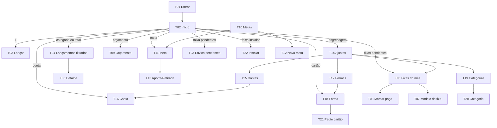
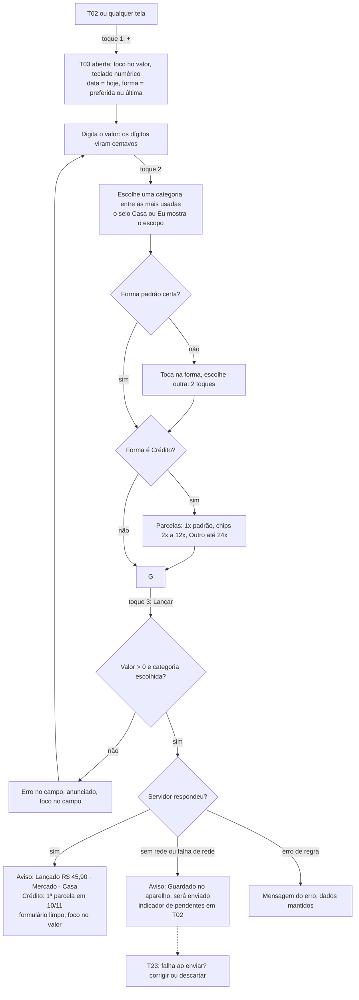
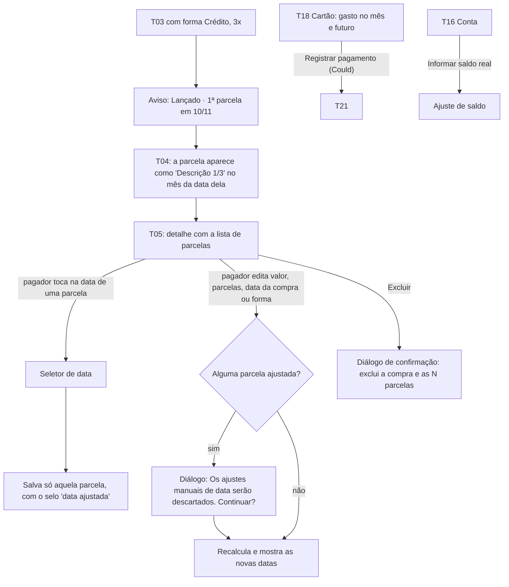
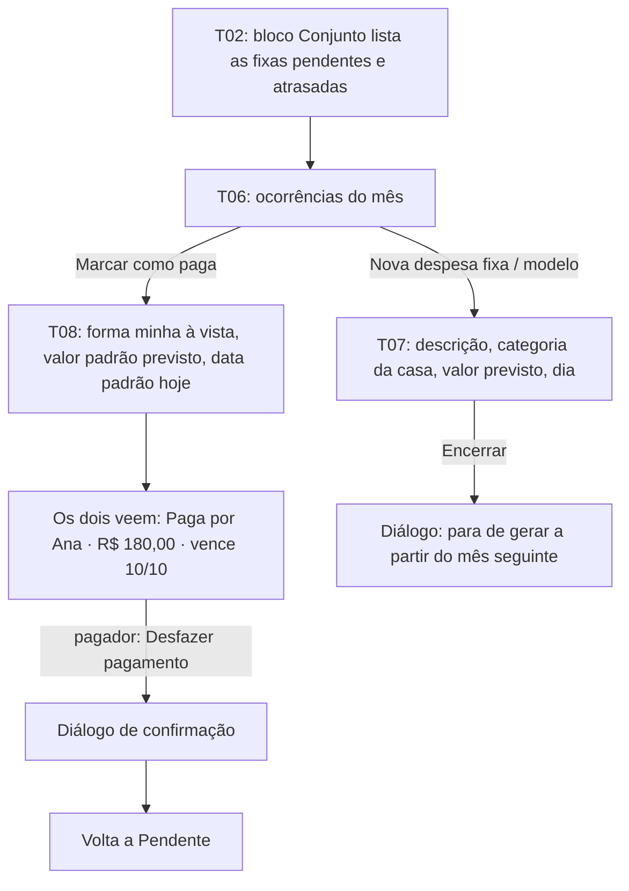

# UX-SPEC.md — MyMoney

**Status:** Aprovado pelo stakeholder em 2026-10-09, junto com o SDD.md e o mockup completo (Loop B
encerrado). B1 aprovada e direção visual C escolhida em 2026-10-09.

**Histórico:**
- **Rodada 2 (B1):**
  - saíram o aviso de "backup atrasado" e a linha "Último backup";
  - aparelhos de teste: iPhone 17 (iOS 26.x) e Moto Edge 60;
  - R-UX-06, R-UX-07 e R-UX-12 adotados.
- **B3:**
  - §0 e §3 apontam para o mockup e o `tokens.css`;
  - o tema é só escuro;
  - a legibilidade no celular foi reforçada;
  - ajustes de layout (T02 cabeçalho, T03 chips 3×3, T08 nota, T09 e cadastros no PC) estão marcados como "(B3)".

**Base:** `.md/PRD-TECNICO.md` (fluxos F0 a F5, matriz F4) e `.md/SDD.md` (contrato da API, ADRs 001 a 011).

---

## 0. Mockup Aprovado

**Situação:** mockup completo (B3) **aprovado pelo stakeholder em 2026-10-09**. É a referência visual das
tarefas de tela.

- **Mockup:** `.md/mockup/`. A galeria `.md/mockup/index.html` está publicada em
  https://claude.ai/artifact/EV6C3zSheYmFDRqirio5in (versão aprovada em 2026-10-09).
- **Direções da B2** (histórico, **não usar como referência**): `.md/mockup/direcoes/`, publicadas em
  https://claude.ai/artifact/TaJ5cRu5fJqMn8WQ6NY71C. Eram A (Clara e sóbria), B (Colorida e amigável) e
  **C (Noturna e densa), a escolhida em 2026-10-09**, sem mistura e sem ajustes. Na B3, só a escala de
  tamanhos do celular mudou (§3).
- **Fonte da aparência:**
  - `.md/mockup/tokens.css` (cores, tipografia, espaços, raios, sombras, breakpoints);
  - `.md/mockup/base.css` (componentes);
  - `.md/mockup/fontes/` (IBM Plex Sans e Plex Mono, OFL).
  A implementação copia `tokens.css` e as fontes **sem alterar**.
- **Dados:**
  - `.md/mockup/dados.json` (canônico);
  - `.md/mockup/respostas/*.json` (no formato exato do contrato `api` do SDD §2). As telas mostram exatamente o
    que esses arquivos contêm.

**Regra de precedência:** para aparência (cor, tipografia, espaçamento, disposição) vale o mockup; para
comportamento, dados e acessibilidade vale este documento. Um conflito entre os dois é defeito do planejamento:
corrija o mockup ou o texto antes de aprovar; nunca deixe para o Executor decidir.

**Verificação da fidelidade:**
- O script `.claude/scripts/comparar-visual.mjs` usa `.md/mockup/telas.json`, com o limite padrão de **1%** de
  pixels divergentes por comparação.
- São 58 estados × 2 tamanhos, ou seja, 116 comparações automáticas.
- Os 24 estados que só existem depois de uma interação (toast, validação ao tocar, diálogos, fila, instalação)
  ficam fora do `telas.json`. O Validador os confere com Playwright, executando a interação, ou à mão. A lista
  está na galeria, seção "Conferência manual".

**Tela × página × rota × tamanhos** (todas as páginas são responsivas: o mesmo HTML vale para celular, 390 ×
844, e PC, 1440 × 900):

| Tela | Páginas do mockup (`telas/`) por estado | Rota no app |
|---|---|---|
| T01 / T01b | `entrar--sucesso` (auto), `--carregando`, `--erro`; `redefinir-senha--sucesso` (auto), `--erro` | `/entrar`, `/redefinir-senha` |
| T02 | `inicio--sucesso`, `--vazio`, `--carregando`, `--erro` (todas auto) | `/?mes=AAAA-MM` |
| T03 | `lancar--inicial` (auto), `--vazio` (auto), `--sucesso` (preenchido), `--confirmado`, `--guardado`, `--receita`, `--carregando`, `--erro` | `/lancar` |
| T04 | `lancamentos--sucesso`, `--vazio`, `--carregando`, `--erro` (auto) | `/lancamentos?mes=&escopo=&categoria=&forma=&variavel=` |
| T05 | `lancamento--sucesso` (pagador), `--outro-membro`, `--carregando`, `--erro` (auto); `--descarte`, `--excluir` | `/lancamentos/:id` |
| T06 | `fixas--sucesso`, `--vazio`, `--carregando`, `--erro` (auto) | `/fixas?mes=` |
| T07 | `fixa--sucesso` (auto), `--erro` | `/fixas/nova`, `/fixas/:id` |
| T08 | `pagar-fixa--sucesso`, `--vazio` (auto), `--erro` | `/fixas?mes=&pagar=:ocorrencia` |
| T09 | `orcamento--sucesso`, `--vazio`, `--carregando`, `--erro`, `orcamento-valor--sucesso` (auto) | `/orcamento?mes=&escopo=casa\|eu[&editar=:categoria]` |
| T10 | `metas--sucesso`, `--vazio`, `--carregando`, `--erro` (auto) | `/metas` |
| T11 | `meta--sucesso`, `--vazio`, `--carregando`, `--erro` (auto) | `/metas/:id` |
| T12 | `meta-form--sucesso` (auto), `--erro` | `/metas/nova`, `/metas/:id/editar` |
| T13 | `movimentar-meta--sucesso`, `--retirada`, `--vazio` (auto), `--erro` | `/metas/:id?movimentar=aporte\|retirada` |
| T14 | `ajustes--sucesso` (auto), `ajustes--sair-todos` | `/ajustes` |
| T15 / T16 | `contas--sucesso`, `--vazio`, `--carregando`, `--erro`, `conta--sucesso` (auto); `conta--erro` | `/ajustes/contas`, `/ajustes/contas/:id` |
| T17 / T18 | `formas--sucesso`, `--vazio`, `--carregando`, `--erro`, `forma--sucesso` (auto); `forma--erro` | `/ajustes/formas`, `/ajustes/formas/:id` |
| T19 / T20 | `categorias--sucesso`, `--vazio`, `--carregando`, `--erro`, `categoria--sucesso` (auto); `categoria--erro` | `/ajustes/categorias?tipo=`, `/ajustes/categorias/:id` |
| T21 | `pagamento-cartao--sucesso`, `--vazio` (auto) | `/ajustes/formas/:id?pagamento=1` |
| T22 | `instalar--ios`, `instalar--android` | (faixa na T02 + folha) |
| T23 | `envios--sucesso`, `envios--erro` | (folha a partir do ícone de pendentes) |
| Padrão | `formulario--salvando` (botão "Salvando…" de todo formulário) | — |

As rotas com `?pagar=`, `?editar=`, `?movimentar=` e `?pagamento=` abrem a folha correspondente direto. Elas
existem para links e para a comparação visual, e foram acrescentadas na B3 em relação ao mapa da §1.

---

## 1. Fluxos de Tela

### Mapa de telas e navegação (F0)

| ID | Tela | Rota | Tipo |
|---|---|---|---|
| T01 | Entrar | `/entrar` | Página |
| T01b | Redefinir senha | `/redefinir-senha` | Página |
| T02 | Início (resumo do mês) | `/?mes=AAAA-MM` | Página |
| T03 | Lançar (despesa ou receita) | `/lancar` (abre T02 com a folha aberta) | Folha sobre T02 |
| T04 | Lançamentos do mês | `/lancamentos?mes=&escopo=&categoria=&forma=&variavel=` | Página |
| T05 | Detalhe e edição do lançamento | `/lancamentos/:id` | Página |
| T06 | Despesas fixas do mês | `/fixas?mes=` | Página |
| T07 | Modelo de despesa fixa | `/fixas/nova`, `/fixas/:id` | Página |
| T08 | Marcar fixa como paga | — | Folha sobre T06 ou T02 |
| T09 | Orçamento do mês | `/orcamento?mes=&escopo=casa\|eu` | Página |
| T10 | Metas | `/metas` | Página |
| T11 | Detalhe da meta | `/metas/:id` | Página |
| T12 | Nova ou editar meta | `/metas/nova`, `/metas/:id/editar` | Página |
| T13 | Aporte ou retirada | — | Folha sobre T11 |
| T14 | Ajustes | `/ajustes` | Página |
| T15 | Contas | `/ajustes/contas` | Página |
| T16 | Conta (nova, editar, ajustar saldo) | `/ajustes/contas/nova`, `/ajustes/contas/:id` | Página |
| T17 | Formas de pagamento | `/ajustes/formas` | Página |
| T18 | Forma de pagamento (nova ou editar, resumo do cartão) | `/ajustes/formas/nova`, `/ajustes/formas/:id` | Página |
| T19 | Categorias | `/ajustes/categorias?tipo=despesa\|receita` | Página |
| T20 | Categoria (nova ou editar) | `/ajustes/categorias/nova`, `/ajustes/categorias/:id` | Página |
| T21 | Registrar pagamento do cartão (Could) | — | Folha sobre T18 |
| T22 | Instalar o app | — | Faixa em T02 + folha |
| T23 | Envios pendentes (fila offline) | — | Folha sobre qualquer tela |

**Navegação principal**:

- **No celular:** uma barra inferior fixa com 5 posições: **Início · Lançamentos · [ + Lançar ] · Orçamento ·
  Metas**.
  - O botão central "+" é maior, fica sempre visível e abre a T03 com 1 toque a partir de qualquer tela
    (CA-05.1).
  - Ajustes (cadastros) fica num ícone de engrenagem no cabeçalho da T02.
  - Despesas fixas abre pelo bloco Conjunto da T02 e por Ajustes.
- **No PC:** a barra vira um trilho lateral (§6).

O **seletor de mês** (‹ Outubro de 2026 ›) é o mesmo componente em T02, T04, T06 e T09. O mês escolhido fica no
parâmetro `mes` da URL e é levado de uma tela para outra. O padrão é o mês corrente (RF-14).

### F1: Lançamento rápido de despesa (RF-05, RF-06, RNF-01, RNF-02)

**Contagem do RNF-01** (caminho feliz): "+" (1) → valor digitado → categoria (2) → "Lançar" (3). São **3
toques além do valor**.

- Trocar a forma soma 2 toques e parcelar soma 1 ou 2. Os dois ficam fora da conta, como o RNF permite.
- Descrição e data ficam em "Mais detalhes", recolhido (CA-05.8).

### F1b: Receita (RF-07)

T03 → seletor "Despesa | **Receita**" no topo da folha (toque 1 extra) → valor → categoria de receita → conta de
destino (padrão: a última usada) → "Lançar". **Sem rede:** a receita não entra na fila. A tela avisa "Sem
conexão. A receita não foi salva" e mantém os dados preenchidos (ADR-007).

### F2: Compra no crédito e ajuste de parcela (RF-06, RF-08, RF-19)

### F3: Ciclo da despesa fixa (RF-10 a RF-12)

Para o membro que não pagou, "Desfazer pagamento" não aparece (RN-06).

### F4: Matriz de visibilidade aplicada às telas

| Dado | Onde aparece para o dono, pagador ou autor | Para o outro membro |
|---|---|---|
| Contas, formas, categorias individuais, lançamentos individuais, orçamento individual, metas individuais | T02 (bloco Eu), T04, T05, T09 (Eu), T10, T11, T15 a T20 | **Não existem na interface**: sem item, sem contagem, sem "oculto" |
| Despesa conjunta | T02 (bloco Casa), T04, T05 | T04 e T05 mostram descrição, categoria, valor, data da parcela, k/N, status e "Pago por X". **Não há campo** de forma, conta nem data da compra: nem rótulo, nem "—" |
| Edição de despesa conjunta | Todos os campos | Descrição, valor, data (só se não for crédito) e categoria (lista só com as conjuntas). Forma, parcelas e datas de parcela **não aparecem** (CA-08.3) |
| Trocar a categoria para outro escopo | Só quem lançou vê categorias individuais na lista | Não acontece: a lista mostra só as conjuntas |
| Movimento de meta compartilhada | Valor, data, autor, local e conta (só nas próprias linhas) | Valor, data, autor e local |

### F5: Fechamento do mês e conferência da M1

1. T02 → seletor de mês → mês anterior. O bloco Casa mostra o total, as variáveis, o orçamento e o resultado.
   Se o mês já terminou, o rótulo "parcial" some.
2. T04 com os filtros "Eu + variável + forma X" mostra o total filtrado, que o membro confere com o extrato ou a
   fatura.
3. Para a diferença encontrada:
   - lançar o que faltou: "+";
   - ajustar a data de uma parcela: T05.
4. T09 no mês novo → "Copiar orçamento de setembro".

### F6: Primeiro uso (decorre do RF-04 e da dependência RF-05 → RF-02/RF-03)

1. T01 → login.
2. O sistema cria as categorias iniciais (`inicializar_membro`).
3. T02 no estado vazio mostra um **cartão de primeiros passos** com 3 itens marcáveis:
   - "Cadastre uma conta" → T16;
   - "Cadastre uma forma de pagamento" → T18;
   - "Instale o app" → T22.
4. Enquanto não existir forma de pagamento, o "+" abre a T03 com o estado vazio: "Cadastre uma forma de pagamento
   para lançar", com o botão "Cadastrar forma".

### F7: Envio pendente (RNF-02)

1. Faixa em T02: "2 lançamentos aguardando envio".
2. Toque → T23, com a lista de pendentes.
3. Cada item mostra valor, categoria, data e situação ("aguardando" ou "falhou: categoria arquivada").
4. As ações são "Tentar agora", "Corrigir" (abre a T03 preenchida) e "Descartar" (pede confirmação).

---

## 2. Wireframes e Layout por Tela

O layout base é o **celular** (cerca de 390 px de largura). Toda tela tem **uma ação principal**, e as adaptações
ficam na §6. Nos layouts abaixo, **"Casa"** é o rótulo de interface para *Conjunto* e **"Eu"** é o rótulo para
*Individual*. Os dois rótulos vêm sempre com ícone (§5).

**T01 Entrar**
- Logo e nome "MyMoney".
- Campo E-mail (`type=email`, `autocomplete=username`).
- Campo Senha (`autocomplete=current-password`, botão mostrar ou ocultar).
- Botão **Entrar** (ação principal).
- Link "Esqueci minha senha", que envia o e-mail de redefinição e confirma: "Se o e-mail for de um membro,
  você vai receber um link".
- Não existe "Criar conta".

**T01b Redefinir senha**
- Nova senha + confirmação (mínimo de 12 caracteres, com regra visível).
- Botão **Salvar senha** (ação principal).

**T02 Início (resumo do mês)**. Ação principal: **+ Lançar**.
- **Cabeçalho:**
  - seletor de mês à esquerda. No celular não cabem marca, seletor centralizado e 2 ícones em 390 px, então a
    marca sai do cabeçalho móvel. No PC, a marca fica no trilho lateral;
  - à direita, o ícone de envios pendentes (com contador, só se houver) e a engrenagem (Ajustes).
- **Faixas condicionais:** sem conexão; envios pendentes; instalar o app (só no navegador do celular,
  dispensável).
- **Bloco Casa** (título "Casa", ícone de casa), sempre primeiro:
  1. **Total do casal** em destaque, com o rótulo "parcial" enquanto o mês não termina. Abaixo, "Variáveis da
     casa: R$ X" e "Previsto a pagar (fixas pendentes): R$ Y".
  2. **Quem pagou:** uma linha por membro com nome e valor, e uma barra proporcional com o valor também em
     texto.
  3. **Fixas pendentes e atrasadas:** até 3 itens (descrição, vencimento, valor previsto, selo "Atrasada" com
     ícone) com o botão "Marcar paga" (abre a T08), mais "Ver todas" (T06). Sem pendentes: "Todas as fixas do
     mês pagas".
  4. **Orçamento da casa:** orçado × realizado total, barra, percentual e situação em texto (Dentro, Atenção ou
     Estourado), mais as 3 categorias com maior percentual. "Ver orçamento" leva à T09 (Casa).
  5. **Por categoria:** lista categoria → total, com o selo "variável". Cada linha abre a T04 filtrada.
  6. **Resultado da casa:** orçamento − total, com o rótulo "parcial".
  7. **Metas da casa:** cartão compacto por meta (nome, barra, "faltam R$ X", %). Abre a T11.
- **Bloco Eu** (título "Eu · {nome}", ícone de pessoa), sempre abaixo:
  1. **Meu total** em destaque = "Minha parte na casa R$ A + Meu individual R$ B" (as duas parcelas visíveis,
     CA-13.3). Abaixo, "Variáveis: R$ X".
  2. **Receitas e resultado:** receitas do mês, resultado (receitas − meu total), "guardado no mês" e o rótulo
     "parcial".
  3. **Meu orçamento:** igual ao da casa. Abre a T09 (Eu).
  4. **Por categoria:** as minhas categorias e a minha parte por categoria da casa, cada uma abrindo a T04.
  5. **Contas:** nome e saldo de cada conta. Abre a T16.
  6. **Cartões:** por forma de Crédito, "neste mês R$" e "próximos meses R$". Abre a T18.
  7. **Minhas metas:** cartões compactos.
- Cada seção tem título como cabeçalho (`h2`/`h3`) para navegação por leitor de tela. Seções sem dado mostram
  uma linha de estado vazio com uma ação, sem esconder a seção.

**T03 Lançar** (folha que sobe de baixo e cobre cerca de 90% da altura). Ação principal: **Lançar**.
1. **Topo:** alça, seletor "Despesa | Receita" (Despesa é o padrão) e o botão Fechar (X).
2. **Valor:** campo grande "R$ 0,00", com foco e teclado numérico (`inputmode=numeric`). Os dígitos entram
   pela direita (centavos). Tem o rótulo visível "Valor".
3. **Categoria:** grade de **3 colunas × 3 linhas**, com as 8 mais usadas pelo membro e "Outras…" como 9º chip,
   como grupo de botões de opção. **(B3)** Antes eram 2 linhas de 4: em 390 px, 4 colunas deixavam o nome
   ilegível. Com 3 colunas, o nome cabe em até 2 linhas de 16 px e as 3 linhas ficam acima do teclado. O chip
   selecionado mostra o ícone de marcado, além da cor.
   - Cada chip tem o nome e o selo de escopo (ícone de casa + "Casa", ou ícone de pessoa + "Eu").
   - O último chip é "Outras…", que abre uma lista com busca, agrupada em "Casa" e "Minhas".
   - Na receita, aparecem só as categorias de receita.
4. **Forma de pagamento:** um botão-chip com o nome da forma atual e o tipo ("Pix Nubank · Pix"). O toque abre
   a lista das minhas formas e a escolha fecha a lista, somando 2 toques.
   - **Lista aberta (decidido no BK-0004, desenho A; mockup `lancar--forma-aberta`):** a lista abre **inline**,
     logo abaixo do botão, como um `GrupoChips` em linha (`radiogroup`, uma opção por chip, alvo mínimo de 44 px,
     a marcada com ícone de marcado além da cor). Não é menu flutuante nem folha por cima da folha. O botão usa
     `aria-expanded` e `aria-controls` (não `aria-haspopup`). Ao abrir, o foco vai para a opção marcada; setas
     navegam; escolher (toque ou Enter, mesmo a já marcada) fecha a lista e devolve o foco ao botão; Esc fecha e
     devolve o foco; sair do foco para fora fecha sem puxar o foco de volta. A forma escolhida decide se as
     Parcelas (item 5) aparecem.
   - Na receita, este campo vira **Conta de destino**, com o mesmo comportamento e sem o tipo ao lado do nome
     (mockup `lancar--conta-aberta`).
5. **Parcelas:** só quando a forma é Crédito. Chips "À vista", 2x, 3x, 4x, 5x, 6x, 10x, 12x e "Outro" (passo
   a passo de 1 a 24). Abaixo, o texto "Entra a partir do próximo vencimento do cartão".
6. **"Mais detalhes"** (recolhido): Data (padrão "Hoje", abre o seletor de data) e Descrição (opcional).
7. **Botão fixo** acima do teclado: "**Lançar R$ 45,90**", com o valor no rótulo. Fica sempre habilitado: ao
   tocar com dados faltando, mostra o erro no campo.
8. Depois do sucesso, aparece um aviso (*toast*) por cerca de 4 s:
   - Pix e Débito: "Lançado: R$ 45,90 · Mercado · Casa";
   - Crédito: "Lançado em 3x · 1ª parcela em 10/11";
   - fila: "Guardado no aparelho. Será enviado quando houver conexão".
   Em seguida, o valor e a categoria são limpos, a forma é mantida e o foco volta ao valor. A folha continua
   aberta para o próximo lançamento (CA-05.7).
- **Abertura pelo "+":** a folha é parte da página, já montada. O mesmo toque no "+" a exibe e dá o foco no
  valor, para o iOS abrir o teclado (§7, R-UX-01).

**T04 Lançamentos do mês**. Ação principal: filtrar e conferir.
- **Cabeçalho:** seletor de mês.
- **Filtros** em chips:
  - Escopo: Todos, Casa ou Eu;
  - Categoria: lista;
  - Forma: lista com as minhas formas, e só filtra os meus lançamentos;
  - Variável: Sim ou Todos (apoio à M1; usa a marca da categoria).
- **Total filtrado** fixo no topo da lista: "Total: R$ 1.234,56 · 37 lançamentos".
- **Lista agrupada por dia** (mais recente primeiro). Cada linha tem:
  - à esquerda, o ícone de escopo;
  - a descrição (ou a categoria, sem descrição), com "(k/N)" quando parcelado;
  - em baixo, a categoria e, na despesa conjunta, "Pago por {nome}";
  - à direita, o valor. A receita aparece com "+" e o rótulo "Receita".
  Cada linha abre a T05.
- Rodapé: lançamentos da fila (se houver) com o selo "aguardando envio", sem entrar no total.

**T05 Detalhe e edição**. Ação principal: **Salvar alterações**.
- **Resumo no topo:**
  - valor e categoria (selo de escopo);
  - "Pago por {nome}" (conjunta);
  - "Parcela k de N" (se for o caso);
  - "Alterado por último por {nome} em dd/mm".
- **Formulário** (o que aparece depende do papel, F4):
  - **Pagador ou dono:** valor total, categoria (todas as minhas e as da casa), descrição, data da compra,
    forma e número de parcelas. No Crédito, a **lista de parcelas** (k/N, valor, data com botão "Alterar
    data", selo "data ajustada").
  - **Outro membro** (despesa conjunta): valor total, categoria (só as da casa), descrição e data (só se não
    for crédito). Uma nota informa: "Forma de pagamento e parcelas: só quem pagou pode alterar".
- Botão secundário **Excluir** (estilo destrutivo), que abre um diálogo de confirmação com o texto exato:
  "Excluir esta compra e as 3 parcelas?".
- Diálogo I-21 antes de salvar, quando houver parcelas ajustadas e a mudança for na compra inteira.

**T06 Despesas fixas do mês**. Ação principal: **Marcar como paga** (por item).
- **Cabeçalho:** seletor de mês.
- **Resumo:** "Pagas: 4 de 6 · Previsto a pagar R$ Y".
- **Lista de ocorrências.** Cada uma tem descrição, categoria, vencimento, valor (previsto, ou efetivo quando
  paga) e situação com ícone e texto:
  - Pendente;
  - **Atrasada**, que vem primeiro na lista;
  - Paga por {nome}.
  As ações são "Marcar como paga", ou "Desfazer pagamento" (só para o pagador).
- Seção "Modelos": lista dos modelos ativos (abre a T07) e o botão "Nova despesa fixa".

**T07 Modelo de fixa**. Ação principal: **Salvar**.
- Descrição, categoria (só as despesas da casa), valor previsto e dia de vencimento (1 a 31, com a nota "em
  meses mais curtos, vale o último dia").
- Em modelo existente: "Encerrar despesa fixa", com diálogo.

**T08 Marcar como paga** (folha). Ação principal: **Confirmar pagamento**.
- Forma (as minhas, à vista), valor efetivo (padrão: o previsto) e data (padrão: hoje). A forma usa o mesmo
  `BotaoForma` + `ListaFormas` da T03 (item 4): lista aberta inline, `GrupoChips` em linha, `radiogroup`,
  2 toques, `aria-expanded` (BK-0004; referência visual `lancar--forma-aberta`).
- Nota sempre visível **(B3)**: "Se pagar no cartão de crédito: conta em outubro na casa e aparece no cartão no
  próximo vencimento" (I-20). Fica sempre na folha para não mudar o layout ao trocar a forma.
- **Sem rede:** avisa e mantém os dados.

**T09 Orçamento do mês**. Ação principal: **Definir valor** (por categoria) ou **Copiar do mês anterior**
(quando vazio).
- Cabeçalho com o seletor de mês e o seletor "Casa | Eu".
- **Linha de total:** orçado, realizado, %, situação em texto e ícone, e o resultado.
- **Lista das categorias orçadas:** nome, barra, "R$ realizado de R$ orçado", % e situação. O toque abre a
  edição do valor (folha com campo de valor + Salvar + "Remover orçamento").
- Seção recolhida "Sem orçamento", com as categorias de despesa do escopo e o botão "Definir".
- Mês sem orçamento: "Sem orçamento da casa em outubro" com o botão "**Copiar de setembro**" (CA-15.4).

**T10 Metas**. Ação principal: **Nova meta**.
- Duas seções: "Da casa" (compartilhadas) e "Minhas".
- Cada cartão tem o nome, a barra, "Guardado R$ X de R$ Y", "**Faltam R$ Z**" e %.
  - Com prazo: "Até dez/2027 · R$ W por mês".
  - Meta atingida: selo "Atingida" com ícone.

**T11 Detalhe da meta**. Ação principal: **Aportar**.
- **Resumo:** guardado, alvo, faltam, %, prazo e valor mensal necessário.
- "Onde está guardado": lista local → valor.
- **Histórico:** valor (+ ou −), data, autor e local. Na linha do próprio membro, também a conta.
- Botões **Aportar** (principal), "Retirar" e "Editar meta".

**T12 Nova ou editar meta**. Ação principal: **Salvar**.
- Nome, valor-alvo, prazo (mês e ano, opcional) e escopo: "Minha" ou "Da casa".
- O escopo só é escolhido na criação: depois, aparece como texto (§7, R-UX-06).

**T13 Aporte ou retirada** (folha). Ação principal: **Confirmar**.
- Seletor "Aporte | Retirada", valor e data.
- "Onde está guardado":
  - no aporte, texto com sugestões dos locais já usados;
  - na retirada, escolha entre os locais com saldo, mostrando o saldo de cada um.
- Conta: as minhas, opcional, com a nota "Debita ou credita o saldo da conta. Só você vê".
- Erro do CA-18.3 no campo de valor.

**T14 Ajustes**. Ação principal: navegar.
- **Lista:** Contas, Formas de pagamento, Categorias e Despesas fixas.
- **"Aplicativo":** Instalar o app (se não estiver instalado) e a versão.
- **"Sessão":** Sair e Sair de todos os aparelhos (com diálogo).

**T15 Contas**. Ação principal: **Nova conta**.
- Lista com o nome e o saldo atual. O filtro "Mostrar arquivadas" fica desligado por padrão.

**T16 Conta**. Ação principal: **Salvar**.
- Nome e saldo inicial.
- Saldo atual (só leitura), com a ação "**Informar saldo real**": campo de valor, depois "Ajustar". O sistema
  mostra a diferença ("Ajuste de +R$ 12,30") antes de confirmar.
- "Arquivar". "Excluir" só aparece sem vínculos; com vínculos, ao tentar, o sistema oferece "Arquivar".

**T17 Formas de pagamento**. Ação principal: **Nova forma**.
- Lista agrupada por tipo, com a estrela "preferida".
- Nas de crédito, "Neste mês R$ · Próximos meses R$" e "vence dia 10".

**T18 Forma de pagamento**. Ação principal: **Salvar**.
- Nome e tipo (Pix, Débito ou Crédito). O tipo só é escolhido na criação (§7, R-UX-06).
- Pix e Débito: conta de origem (obrigatória).
- Crédito: dia de vencimento (1 a 31, obrigatório) e conta de pagamento padrão (opcional). Ao mudar o dia, a
  nota: "Vale para compras novas. As parcelas já lançadas não mudam".
- Interruptor "Preferida".
- No Crédito, um quadro "Neste mês / Próximos meses" e a ação "Registrar pagamento do cartão" (T21, Could).
- Arquivar e Excluir, com a mesma regra da T16.

**T19 Categorias**. Ação principal: **Nova categoria**.
- Seletor "Despesas | Receitas" e grupos "Da casa" e "Minhas" (receitas: só "Minhas").
- Cada linha tem nome, selo "variável" e a ação de arquivar no detalhe.

**T20 Categoria**. Ação principal: **Salvar**.
- Nome, tipo e escopo (só na criação; receita força "Minha") e o interruptor "Gasto variável" (só despesa).
- Arquivar e Excluir, com a mesma regra.

**T21 Pagamento do cartão** (folha, Could). Ação principal: **Registrar**.
- Valor, data e conta de origem (padrão: a conta de pagamento do cartão).
- Nota: "Sai da conta. Não conta como despesa".

**T22 Instalar o app**. Ação principal: **Instalar** (Android) ou seguir os passos (iOS).
- **Faixa em T02:** "Instale o MyMoney para lançar mais rápido" com Instalar e Dispensar.
- **Folha:**
  - no Android, o botão usa o prompt nativo;
  - no iOS, 3 passos com ícones: Compartilhar → "Adicionar à Tela de Início" → Adicionar.
- Só aparece no navegador de celular, fora do modo instalado, e some depois de dispensada (CA-20.2).

**T23 Envios pendentes** (folha). Ação principal: **Tentar agora**.
- Lista dos itens da fila: valor, categoria, data e situação.
- Ações por item: Corrigir e Descartar (com diálogo).

---

## 3. Design System e Componentes

**Valores em `.md/mockup/tokens.css`.** Cores, tipografia (família, pesos, escala por breakpoint), espaços,
raios, sombras e tamanhos mínimos ficam lá, e não são repetidos aqui. Os estilos dos componentes estão em
`.md/mockup/base.css`, com classes de nome igual ao componente (por exemplo `cartao`, `chip`, `folha`,
`selo-atrasada`). Não existe design system anterior no projeto: todos os componentes abaixo são **novos**.

**Decisões visuais da B3:**
- **Tema único: escuro.** O MVP não terá tema claro derivado. Motivos:
  - a direção escolhida foi o modo noturno;
  - um segundo tema dobraria o mockup e a comparação visual;
  - o PRD não pede tema claro.
  O app declara `color-scheme: dark` e não reage a `prefers-color-scheme`. O `theme_color` do manifest usa
  `--cor-fundo`. Um tema claro, se vier, é release futura e começa por um `tokens.css` alternativo no mockup.
- **Legibilidade no celular** (a densidade da C cansaria nos lançamentos rápidos):
  - texto base de 16 px no celular, contra 14 px no PC;
  - texto secundário de 14 px, contra 12 px no PC;
  - valor em destaque de 32 px no celular, contra 28 px no PC;
  - campo de valor do Lançar com 44 px em Plex Mono;
  - chips de categoria com altura mínima de 64 px;
  - todo alvo de toque com 44 px ou mais.
  No PC, a densidade original da C continua. Só os rótulos da barra inferior e o contador de pendentes usam
  12 px, com contraste de 7,2:1 ou mais.
- **Identidade mantida:**
  - grafite, âmbar = Casa, ciano = Eu;
  - IBM Plex Sans + Plex Mono nos valores;
  - cantos de 6 px;
  - linha colorida no topo dos cartões;
  - títulos de bloco em caixa alta.
- **Fontes auto-hospedadas** em `.md/mockup/fontes/` (OFL). Os `.woff2` são gerados por
  `node .md/mockup/fontes/baixar-fontes.mjs` (R-UX-14).

| Componente | Onde aparece | Variações e estados |
|---|---|---|
| `BarraNavegacao` / `TrilhoNavegacao` | Todas as páginas autenticadas | Item ativo. Botão central "+" |
| `SeletorMes` | T02, T04, T06, T09 | Mês corrente, passado, futuro |
| `SeloEscopo` | T02 a T05, T09, T10, T19 | Casa, Eu (ícone + texto) |
| `CampoValor` (centavos) | T03, T05, T07, T08, T09, T13, T16, T21 | Normal, foco, erro, desabilitado |
| `ChipOpcao` / `GrupoChips` | T03 (categoria, parcelas), T04 (filtros) | Selecionado, foco, desabilitado |
| `BotaoForma` + `ListaFormas` | T03, T08 | Com ou sem forma |
| `Folha` (bottom sheet ou diálogo no PC) | T03, T08, T13, T21, T22, T23 | Aberta, fechando. Armadilha de foco |
| `DialogoConfirmacao` | Exclusões, desfazer, encerrar, I-21, sair de todos | Destrutivo, neutro |
| `Aviso` (toast, `aria-live`) | Pós-ação | Sucesso, guardado offline, erro |
| `Faixa` (banner) | T02 | Offline, pendentes, instalar |
| `CartaoResumo` (bloco e seção) | T02 | Com dado, vazio, carregando (esqueleto) |
| `ValorDestaque` | T02, T11 | Com rótulo "parcial" |
| `BarraProgresso` (orçamento e meta) | T02, T09, T10, T11 | Dentro, atenção, estourado, atingida (sempre com texto) |
| `LinhaLancamento` | T04, T02 | Despesa, receita, conjunta (pago por), parcela k/N, aguardando envio |
| `SeloSituacao` | T06, T09, T05 | Pendente, atrasada, paga, data ajustada |
| `CampoTexto`, `CampoData`, `Interruptor`, `Selecao` | Formulários | Normal, foco, erro, desabilitado |
| `EstadoVazio`, `EstadoErro`, `Esqueleto` | Todas | — |

---

## 4. Estados de Tela

Padrões globais:

- **Carregando:** esqueleto com a forma do conteúdo depois de 300 ms, sem *spinner* de página inteira.
- **Erro de rede em leitura:** mensagem "Não foi possível carregar. Verifique a conexão" + "Tentar de novo",
  mantendo o último dado em cache visível com a faixa "Mostrando dados de {hora}".
- **Erro de regra:** mensagem do código traduzido, junto ao campo.
- **Erro de escrita fora da T03:** a tela avisa e **mantém os dados** (ADR-007).

| Tela | Vazio | Carregando | Erro | Sucesso |
|---|---|---|---|---|
| T01 | N/A: formulário sempre igual | Botão "Entrando…" desabilitado | "E-mail ou senha incorretos" (genérico, sem dizer qual), "Sem conexão" | Vai para T02 |
| T01b | N/A | Botão "Salvando…" | Senha fraca ou não confere (no campo). Link expirado | "Senha alterada" → T01 |
| T02 | Primeiro uso: cartão de primeiros passos (F6). Mês sem lançamentos: "Nada lançado em outubro ainda" + "+ Lançar". Seções vazias com uma linha e uma ação | Esqueleto dos 2 blocos | Faixa de erro + cache, ou estado de erro sem cache. **Supabase pausado ou fora:** "Servidor indisponível. Seus lançamentos de despesa ficam guardados no aparelho" | Blocos preenchidos |
| T03 | Sem forma de pagamento: "Cadastre uma forma de pagamento para lançar" + "Cadastrar forma". Sem categorias (todas arquivadas): "Nenhuma categoria ativa" + "Gerenciar categorias" | "Lançando…" no botão por até 3 s. Passado isso, a operação vai para a fila e mostra o aviso "Guardado no aparelho" | Valor vazio ou zero: "Informe um valor maior que zero". Sem categoria: "Escolha uma categoria". Regra: mensagem no topo da folha. Receita sem rede: "Sem conexão. A receita não foi salva" (dados mantidos) | Aviso do lançamento + formulário pronto para o próximo |
| T04 | "Nenhum lançamento em outubro" / com filtro: "Nenhum lançamento com esses filtros" + "Limpar filtros" | Esqueleto de lista | Padrão global | Lista + total filtrado |
| T05 | N/A: só abre a partir de um item existente. Se o item foi excluído pelo outro membro: "Este lançamento não existe mais" + Voltar | Esqueleto do formulário | Sem permissão ou inexistente: a mesma mensagem genérica. Escrita: avisa e mantém | "Alterações salvas" e volta à T04. Exclusão: "Excluído" e volta à T04 |
| T06 | Sem modelos: "Nenhuma despesa fixa cadastrada" + "Nova despesa fixa". Com modelos e tudo pago: "Todas pagas em outubro" | Esqueleto | Padrão global | Lista |
| T07 | N/A: formulário | Botão "Salvando…" | Campo obrigatório ou dia fora de 1 a 31, no campo | "Despesa fixa salva" → T06 |
| T08 | Sem forma de pagamento: atalho para cadastrar | Botão "Confirmando…" | Avisa e mantém | "Marcada como paga" + item atualizado |
| T09 | Mês sem orçamento: "Copiar de {mês anterior}" (se houver) ou "Definir orçamento" | Esqueleto | Padrão global | Lista com situações |
| T10 | "Nenhuma meta ainda" + "Nova meta" (por seção) | Esqueleto de cartões | Padrão global | Cartões |
| T11 | Sem movimentos: "Nenhum aporte ainda" + "Aportar" | Esqueleto | Padrão global | Detalhe |
| T12 | N/A: formulário | "Salvando…" | Validação no campo | "Meta salva" → T11 |
| T13 | Retirada sem locais com saldo: "Não há valor guardado para retirar" | "Confirmando…" | Retirada maior que o guardado no local (CA-18.3), no campo. Escrita: avisa e mantém | "Aporte registrado" + resumo atualizado |
| T14 | N/A: menu fixo | N/A: conteúdo local, sem chamada à API | N/A. "Sair de todos os aparelhos" sem rede: "Sem conexão. Tente de novo" | Sair: vai para a T01 |
| T15, T17, T19 | "Nenhuma conta / forma / categoria" + ação de criar | Esqueleto | Padrão global | Lista |
| T16, T18, T20 | N/A: formulário | "Salvando…" | Validação. Exclusão em uso: "Esta conta tem lançamentos. Arquive para tirá-la das opções" + "Arquivar" | Aviso salvo → lista |
| T21 | Sem conta corrente: atalho para cadastrar | "Registrando…" | Avisa e mantém | "Pagamento registrado" |
| T22 | N/A: aparece só se aplicável | N/A: conteúdo estático | Prompt nativo indisponível no Android: mostrar os passos manuais | Instalado: a faixa some |
| T23 | N/A: só abre com itens. Fila vazia fecha a folha com "Tudo enviado" | "Enviando…" por item | Falha por item, com o motivo | Item some da lista |

---

## 5. Requisitos de Acessibilidade (WCAG)

**Nível-alvo: WCAG 2.1 AA** (RNF-10), como critério não negociável. Também são obrigatórios: alvo de toque de
44×44 px ou mais e rótulo em todo campo. Na B3, o mockup é conferido contra esta seção **antes** de ser
mostrado. Na implementação, a verificação é `@axe-core/playwright` sem violação *serious* ou *critical* em
cada tela e estado.

**Regras globais (valem para todas as telas):**

| Critério | Requisito | Severidade se violado |
|---|---|---|
| 1.4.3 / 1.4.11 Contraste | Texto ≥ 4,5:1 (≥ 3:1 para texto grande). Componentes, bordas de campo, foco e barras ≥ 3:1 | Crítica |
| 1.4.1 Uso de cor | Escopo (Casa e Eu), situação do orçamento, atrasada, paga, receita e despesa: **sempre ícone + texto**, nunca só cor | Crítica |
| 2.5.5 (meta AAA adotada como requisito pelo RNF-10) / 2.5.8 | Alvos de toque de 44×44 px ou mais, incluindo os chips de categoria e parcelas, o seletor de mês e os ícones do cabeçalho | Crítica |
| 1.3.1 / 4.1.2 Nome, papel, valor | Todo campo com `<label>` visível. Botões só com ícone com `aria-label` ("Mês anterior: setembro de 2026", "Ajustes", "Envios pendentes: 2"). Chips de categoria e parcelas como `radiogroup` | Crítica |
| 2.1.1 Teclado | Toda ação alcançável por teclado, em ordem lógica. Folhas e diálogos com armadilha de foco, Esc para fechar e foco devolvido ao gatilho | Crítica |
| 2.4.7 Foco visível | Anel de foco visível em todo elemento interativo (token na B3) | Crítica |
| 3.3.1 / 3.3.3 / 4.1.3 Erros e avisos | Erro ligado ao campo (`aria-describedby`, `aria-invalid`) e foco no 1º campo com erro. Avisos (*toast*) e erros de topo em região `aria-live` (`polite` para sucesso, `assertive` para erro). O aviso de sucesso fica pelo menos 4 s, e não some com o foco nele | Crítica |
| 1.4.4 / 1.4.10 Zoom e refluxo | Usável a 200% de zoom e a 320 px de largura sem rolagem horizontal. Valores grandes quebram linha, não são cortados | Menor |
| 2.3.3 / preferência de movimento | Animações de folha e barra respeitam `prefers-reduced-motion` | Menor |
| 3.1.1 Idioma | `<html lang="pt-BR">`. Valores lidos como moeda: o texto acessível do valor é "R$ 1.234,56", nunca o número cru em centavos | Menor |
| 2.4.2 Título | `<title>` por tela: "Início · Outubro de 2026 · MyMoney" | Menor |
| 1.3.5 Propósito do campo | `autocomplete` em e-mail e senha | Menor |

**Por tela:**

| Tela | Critério WCAG | Conformidade especificada | Severidade se violado | Correção aplicada na especificação |
|---|---|---|---|---|
| T01, T01b | 3.3.1, 1.3.5, 4.1.3 | Erro genérico anunciado. Mostrar senha com `aria-pressed` | Crítica | Mensagem em `role=alert` |
| T02 | 1.3.1, 2.4.6, 1.4.1 | Blocos e seções com cabeçalhos `h2`/`h3`. Barras com texto (%) e `role=progressbar` + `aria-valuenow`. "Parcial" em texto. Faixas com `role=status` | Crítica | Barra de "quem pagou" com o valor em texto |
| T03 | 2.1.1, 4.1.2, 3.3.1, 4.1.3 | Folha como `dialog` com `aria-modal`. Foco inicial no valor. Chips em `radiogroup` com setas. O botão "Lançar R$ X" tem nome acessível atualizado. O aviso de sucesso é anunciado sem tirar o foco do valor | Crítica | Botão sempre habilitado com validação anunciada (botão desabilitado não explica o motivo) |
| T03 (`CampoValor`) | 4.1.2, 1.3.1 | `inputmode=numeric`, rótulo "Valor". O texto acessível reflete o valor formatado (`aria-describedby` com "R$ 45,90") | Crítica | O leitor de tela lê o valor formatado, não os dígitos crus |
| T04 | 1.3.1, 4.1.3 | A lista é `list`. A linha é um link com nome completo ("Mercado, Casa, pago por Ana, R$ 45,90, 12 de outubro"). O total filtrado fica em `aria-live=polite` quando muda | Menor | — |
| T05 | 3.3.1, 3.3.4 | O diálogo de exclusão e o I-21 exigem confirmação explícita. A nota de campos restritos é texto, não campo desabilitado sem explicação | Crítica | Campos que não se aplicam são **removidos**, não desabilitados |
| T06 | 1.4.1, 4.1.2 | "Atrasada" com ícone + texto. Botões por item com contexto ("Marcar como paga: Aluguel") | Crítica | `aria-label` com o nome do item |
| T07, T12, T16, T18, T20 | 3.3.2 | Regras visíveis antes do erro (dia 1 a 31, senha ≥ 12, conta obrigatória) | Menor | Texto de ajuda sob o campo |
| T08, T13, T21 | 2.1.1, 4.1.3 | Como a T03 (folha, foco, aviso) | Crítica | — |
| T09 | 1.4.1, 4.1.2 | Situação em texto + ícone. O toque na linha abre a edição com o nome "Editar orçamento de Mercado" | Crítica | — |
| T10, T11 | 4.1.2 | Barra com o texto "45%, faltam R$ 1.200,00". O histórico é uma tabela ou lista com cabeçalhos | Menor | — |
| T14 | 3.3.4 | "Sair de todos os aparelhos" com diálogo | Menor | — |
| T22 | 1.1.1 | Os ícones dos passos do iOS têm texto alternativo, e os passos estão em texto | Menor | — |
| T23 | 4.1.3 | A situação de cada item é anunciada ao mudar | Menor | — |

**Pendências críticas em aberto:** nenhuma.

**Contraste conferido na B3:**
- todos os pares de `tokens.css` passam no AA;
- a tabela completa está na galeria (`.md/mockup/index.html`, seção "Contraste");
- piores casos: texto de erro sobre a folha (5,3:1), selo Estourado (5,8:1), contorno de campo sobre a folha
  (3,2:1) e barra vermelha sobre a trilha (4,4:1).

Nenhum desvio foi pedido. No celular, o texto informativo tem 14 px ou mais e o texto base tem 16 px (§3).

---

## 6. Comportamento Responsivo

**Contextos de uso confirmados** (PRD §2 e RNF-05):

- **celular** para lançar e acompanhar (prioridade);
- **computador** para acompanhar o mês.

O tablet não é citado e herda o layout de celular com margens maiores. Orientação: retrato no celular. Em
paisagem o app funciona, mas sem layout próprio.

| Breakpoint | Mudança de layout | Prioridade de conteúdo | Mudança de interação |
|---|---|---|---|
| < 600 px (celular, **base**) | Uma coluna. Barra inferior com "+" central. Folhas de baixo para cima. Cabeçalho compacto | T02: o bloco Casa primeiro, depois o Eu, cada um com as seções na ordem da §2 | Toque. Sem *hover*. Folha fecha ao arrastar para baixo ou no X. Puxar para atualizar em T02 e T04 |
| 600 a 1023 px (tablet ou janela estreita) | Igual ao celular, com conteúdo centralizado (largura máxima de cerca de 640 px) | Igual | Toque ou mouse |
| ≥ 1024 px (PC) | **Trilho lateral** fixo à esquerda (Início, Lançamentos, Orçamento, Metas, Ajustes) com o botão "+ Lançar" no topo. Conteúdo até cerca de 1120 px. Em T02, os blocos continuam **empilhados** (Casa em cima, Eu embaixo, que é a ordem do stakeholder), mas as seções de cada bloco viram grade de 2 a 3 colunas. Em T04, a lista vira tabela (data, descrição, categoria, pago por, valor). **Folhas viram diálogos centralizados** (largura de cerca de 480 px) | Total do casal e Meu total continuam no topo de cada bloco | Mouse e teclado. *Hover* só como reforço, nunca como único meio. Atalho "Ctrl/⌘ + Enter" confirma o lançamento na T03. O seletor de mês aceita as setas do teclado |

**Telas com ajuste específico:**

| Tela | Celular | PC |
|---|---|---|
| T03 | Folha de até 90% da altura, botão fixo no rodapé da folha, acima do teclado (`visualViewport`). Grade de categorias 3×3 | Diálogo de 480 px. A grade continua 3×3 **(B3)** |
| T04 | Lista por dia | Tabela com filtros em linha acima |
| T09 | Cartão de total e lista com barras, empilhados | Duas colunas: cartão de total à esquerda e lista por categoria à direita **(B3: substitui a tabela; a barra de cada linha não cabia como coluna)** |
| T11 | Histórico em lista | Resumo e "onde está guardado" lado a lado. Histórico em tabela |
| T15 a T20 e formulários | Lista e formulário em páginas separadas | Também páginas separadas, com conteúdo estreito (cerca de 720 px) **(B3: o mestre e detalhe saiu; para 2 a 5 itens por cadastro, ele dobraria telas e testes sem ganho)** |

---

## 7. Restrições Técnicas Aplicadas e Conflitos Sinalizados

Autochecagem de todas as telas contra o SDD.md (componente, desempenho, stack e isolamento). As decisões de
trade-off são do próprio Coordenador. Os itens que estavam em pergunta ao stakeholder foram adotados na rodada
2 como padrão, sem objeção dele.

| # | Tela | Restrição do SDD.md | Descrição e decisão | Status |
|---|---|---|---|---|
| R-UX-01 | T03 | RT-02 (iOS só abre o teclado com foco dentro de um gesto) | A T03 é uma folha **já montada** na página. O toque no "+" a exibe e dá o foco no mesmo handler, de forma síncrona. A rota `/lancar` existe para a comparação visual e para links, mas aberta direto (sem toque) **não** garante o teclado no iOS. Spike no Loop C com o **iPhone 17 (iOS 26.x)**, instalado e no Safari, e com o **Moto Edge 60** (Chrome) | Decidido. Spike a planejar |
| R-UX-02 | T03 (crédito sem rede) | ADR-007: a data da 1ª parcela é calculada no servidor | Sem rede, o aviso diz "Guardado no aparelho" e não mostra a data da 1ª parcela. A data aparece na T23 e no aviso de envio concluído ("Enviado: 1ª parcela em 10/11"). Calcular no aparelho violaria a regra "tela não recalcula" | Decidido (trade-off de detalhe) |
| R-UX-03 | T03, T04, T06, T09 | ADR-007: só o lançamento de despesa funciona sem rede | Receita, edição, fixas, orçamento, metas e cadastros avisam e mantêm os dados. As leituras mostram o último cache com a faixa "Mostrando dados de {hora}" | Decidido |
| R-UX-04 | T02, T04 | SDD §6, dívida "sem tempo real" | O que o outro lança aparece ao voltar ao app (foco) ou ao puxar para atualizar. Não há atualização ao vivo | Decidido |
| R-UX-05 | T05 | ADR-002, ADR-003: os campos privados não vêm na resposta para o outro membro | A tela **remove** os campos ausentes (forma, conta, data da compra, parcelas editáveis) em vez de mostrar "—" ou um campo desabilitado. Não deixa pista de que existe um dado escondido além do que a RN-04 já admite | Decidido |
| R-UX-06 | T12, T18, T20 | Integridade do modelo (ADR-005) e privacidade (ADR-002) | O escopo da meta e da categoria e o tipo da forma de pagamento **não mudam depois de criados**. Mudar o escopo da meta exporia o histórico de aportes. Mudar o tipo da forma quebraria parcelas e saldo. Para mudar, o membro cria outro e arquiva o antigo. É uma interpretação de detalhe, porque o PRD não pede essa edição | **Adotado: padrão do Coordenador, sem objeção do stakeholder** (rodada 2) |
| R-UX-07 | T03 (`CampoValor`) | ADR-004: centavos inteiros | Os dígitos entram pela direita ("4590" → R$ 45,90), sem tecla de vírgula. Isso evita o teclado com vírgula, que muda entre Android e iOS, e o erro de digitação de casas decimais. O custo é o estranhamento inicial, a validar na M3 | **Adotado: padrão do Coordenador, sem objeção do stakeholder** (rodada 2) |
| R-UX-08 | Todas (comparação visual) | `comparar-visual.mjs` intercepta as chamadas de API | As respostas do mockup (`respostas/*.json`) seguem o formato do contrato `api` do SDD §2, com URLs `**/rest/v1/rpc/<funcao>` e `**/rest/v1/<view>*`. Decisões da B3: (1) O app tem um modo de comparação com sessão falsa do Supabase e outro sem sessão, para T01 e T01b. A tarefa que cria esses modos é do Loop C. (2) Com uma folha ou diálogo aberto, o app põe `com-folha` no `<html>`, que trava a rolagem. O `telas.json` oculta `.conteudo` nos dois lados, então a captura não depende do que está por trás. (3) Os estados que só existem depois de uma interação ficam fora do `telas.json` e são conferidos à mão (lista na galeria) | Decidido (B3) |
| R-UX-14 | Todas | ADR-006 (fontes no bundle, CSP sem terceiros) | O Coordenador não grava arquivos binários. Por isso, os `.woff2` das fontes são gerados por `node .md/mockup/fontes/baixar-fontes.mjs` (Google Fonts, subconjunto latin), que roda uma vez antes da implementação. As páginas do mockup mantêm o Google Fonts só como segunda opção da pilha de fontes. O app usa só os arquivos locais | **Resolvido** em 2026-10-09: os 6 `.woff2` estão em `.md/mockup/fontes/` |
| R-UX-15 | Todas | ADR-006 | Tema único escuro (§3). Sem `prefers-color-scheme` e sem alternância de tema | Decidido (B3) |
| R-UX-09 | T22 | iOS: sem prompt de instalação. P4 | No iOS, só as instruções. No Android, o botão usa `beforeinstallprompt` | Decidido |
| R-UX-10 | T02 (bloco Casa, "Quem pagou") | RN-16e | "Quem pagou" usa só despesas conjuntas (dado visível aos dois). O bloco Eu do outro membro nunca aparece, nem resumido | Verificado: sem conflito |
| R-UX-11 | T05 (conjunta no crédito, visão do outro membro) | I-22, RT-12 | A data da parcela é visível e pode revelar o dia de vencimento do cartão do pagador. Aceito pelo produto | Registrado |
| R-UX-12 | T06, T05 (fixa paga) | SDD §2, interpretação técnica | O outro membro vê o **vencimento da ocorrência** como data da fixa paga, e não a data em que o pagador pagou | **Adotado: padrão do Coordenador, sem objeção do stakeholder** (rodada 2) |
| R-UX-13 | T02, T14 | ADR-010 (backup adiado) | Sem aviso de backup e sem "Último backup". A exclusão de dados continua sempre com diálogo de confirmação (§4), porque não há como recuperar um dado apagado | Decidido (rodada 2) |

**Conflitos em aberto com a arquitetura:** nenhum. Todos foram decididos dentro do próprio Coordenador. A
pendência operacional R-UX-14 (gerar os `.woff2`) foi resolvida em 2026-10-09.
